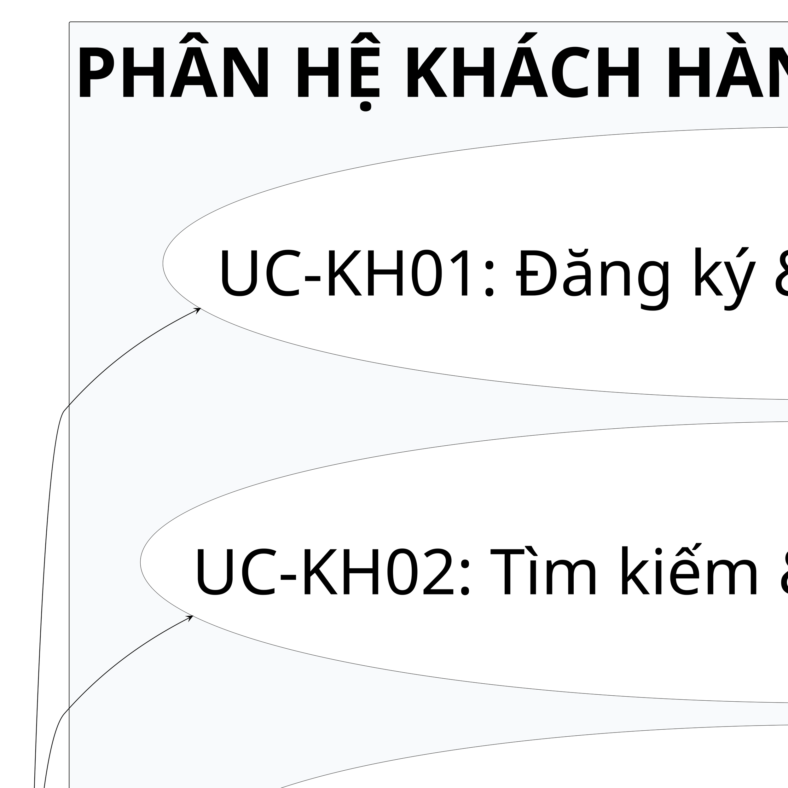
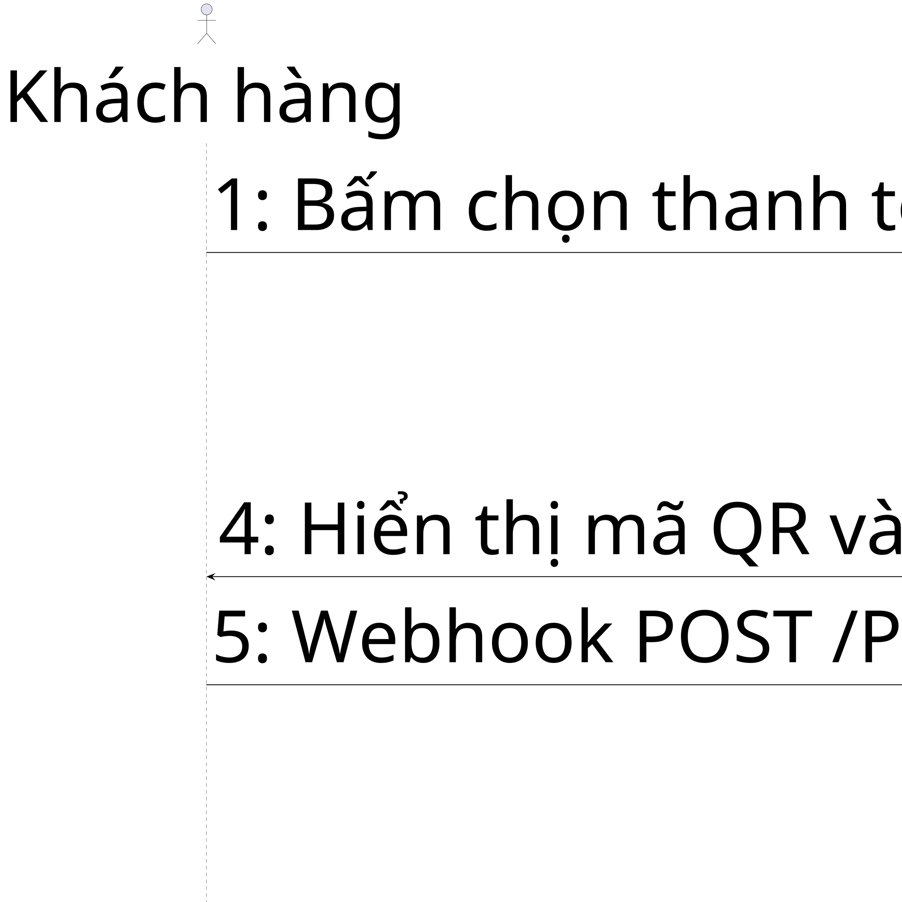
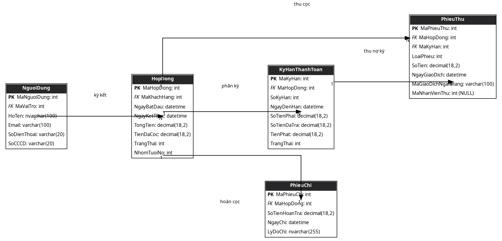
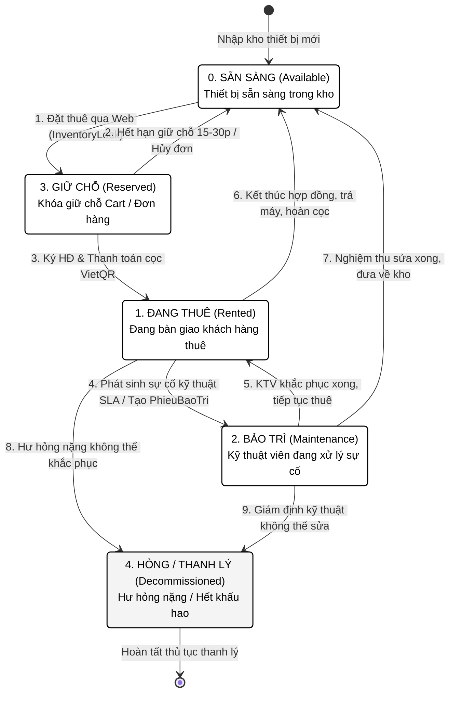

# HƯỚNG DẪN TẠO HÌNH SƠ ĐỒ KỸ THUẬT VÀ BÁO CÁO ĐÁNH GIÁ ĐỒ HỌA HỌC THUẬT
## BỘ ĐẶC TẢ PROMPT ENGINEERING CHO GEMINI 3.8 FLASH — CHUẨN IN ẤN A4 (300 DPI)
**Dự án**: Hệ thống Quản lý và Cho thuê Thiết bị Công nghệ RentalSystem  
**Đơn vị thực hiện**: Khóa luận Tốt nghiệp Ngành Kỹ thuật Phần mềm — Trường Đại học Công Thương TP. Hồ Chí Minh (HUIT)  
**Tác giả / Tổng hợp**: Tổ Chuyên gia Đồ họa Học thuật & Đảm bảo Chất lượng Phần mềm RentalSystem  
**Căn cứ tài liệu**: `KHOA_LUAN_TOT_NGHIEP_RENTALSYSTEM_HUIT_2025.docx`, `BaoCao_KLCN058_Final.docx`, `tools/render_all_diagrams.py`, `tools/sync_thesis_documents.py`, `tools/clean_ai_hallucinations.py`  
**Phiên bản**: 1.0 (Chính thức - Print-Ready Release)  
**Ngày phát hành**: Tháng 10/2026

---

## MỤC LỤC TỔNG QUAN

- [PHẦN 1: GIỚI THIỆU & TRIẾT LÝ THIẾT KẾ ĐỒ HỌA HỌC THUẬT](#phần-1-giới-thiệu--triết-lý-thiết-kế-đồ-họa-học-thuật)
  - [1.1. Bối cảnh & Mục đích tài liệu](#11-bối-cảnh--mục-đích-tài-liệu)
  - [1.2. Quy chuẩn đồ họa ấn phẩm học thuật HUIT khổ A4](#12-quy-chuẩn-đồ-họa-ấn-phẩm-học-thuật-huit-khổ-a4)
  - [1.3. Triết lý Academic Monochrome / Grayscale](#13-triết-lý-academic-monochrome--grayscale)
  - [1.4. Tôn chỉ Không Rác Thị Giác (Zero In-Image Noise Principle)](#14-tôn-chỉ-không-rác-thị-giác-zero-in-image-noise-principle)
- [PHẦN 2: BÁO CÁO ĐÁNH GIÁ TOÀN DIỆN CÁC SƠ ĐỒ KỸ THUẬT TRONG TÀI LIỆU WORD](#phần-2-báo-cáo-đánh-giá-toàn-diện-các-sơ-đồ-kỹ-thuật-trong-tài-liệu-word)
  - [2.1. Thẩm định tính đồng bộ nhị phân giữa hai tệp tài liệu Word](#21-thẩm-định-tính-đồng-bộ-nhị-phân-giữa-hai-tệp-tài-liệu-word)
  - [2.2. Phân tích lỗi nghiêm trọng: Hiện tượng trôi lệch ánh xạ ảnh (OpenXML Media Slot Drift)](#22-phân-tích-lỗi-nghiêm-trọng-hiện-tượng-trôi-lệch-ánh-xạ-ảnh-openxml-media-slot-drift)
  - [2.3. Danh mục toàn bộ 72 hình ảnh kỹ thuật từ Hình 2.1.1.1 đến hết Chương 4](#23-danh-mục-toàn-bộ-72-hình-ảnh-kỹ-thuật-từ-hình-2111-đến-hết-chương-4)
  - [2.4. Phân tích chuyên sâu 6 khiếm khuyết đồ họa kỹ thuật cụ thể](#24-phân-tích-chuyên-sâu-6-khiếm-khuyết-đồ-họa-kỹ-thuật-cụ-thể)
- [PHẦN 3: BỘ HƯỚNG DẪN PROMPT ENGINEERING & SPECIFICATION GUIDE CHO GEMINI 3.8 FLASH](#phần-3-bộ-hướng-dẫn-prompt-engineering--specification-guide-cho-gemini-38-flash)
  - [3.1. System Prompt chuẩn hóa: Academic Technical Diagram Architect](#31-system-prompt-chuẩn-hóa-academic-technical-diagram-architect)
  - [3.2. Năm bộ Template Prompts mẫu hoàn chỉnh & Mã nguồn thực thi 100%](#32-năm-bộ-template-prompts-mẫu-hoàn-chỉnh--mã-nguồn-thực-thi-100)
    - [Template 1: Use Case Diagram (PlantUML)](#template-1-use-case-diagram-plantuml)
    - [Template 2: Sequence Diagram (PlantUML)](#template-2-sequence-diagram-plantuml)
    - [Template 3: Relational ERD & Class Diagram (Graphviz DOT)](#template-3-relational-erd--class-diagram-graphviz-dot)
    - [Template 4: Architecture & Technical Payload Diagram (Matplotlib Python)](#template-4-architecture--technical-payload-diagram-matplotlib-python)
    - [Template 5: State Machine Diagram / Flowchart (Mermaid)](#template-5-state-machine-diagram--flowchart-mermaid)
- [PHẦN 4: BỘ THÔNG SỐ KỸ THUẬT TẠO HÌNH CHUẨN IN ẤN KHỔ A4](#phần-4-bộ-thông-số-kỹ-thuật-tạo-hình-chuẩn-in-ấn-khổ-a4)
  - [4.1. Bảng quy chuẩn kỹ thuật toàn diện](#41-bảng-quy-chuẩn-kỹ-thuật-toàn-diện)
  - [4.2. Công thức toán học phân cấp cỡ chữ (Typography Math Formulation)](#42-công-thức-toán-học-phân-cấp-cỡ-chữ-typography-math-formulation)
  - [4.3. Bảng mã màu Grayscale chuẩn hóa và Phân vùng thị giác](#43-bảng-mã-màu-grayscale-chuẩn-hóa-và-phân-vùng-thị-giác)
  - [4.4. Quy chuẩn kỹ thuật hình học cho liên kết Actor - Use Case](#44-quy-chuẩn-kỹ-thuật-hình-học-cho-liên-kết-actor---use-case)
- [PHẦN 5: MA TRẬN RÀNG BUỘC NGHIỆP VỤ RENTALSYSTEM CHỐNG ẢO GIÁC](#phần-5-ma-trận-ràng-buộc-nghiệp-vụ-rentalsystem-chống-ảo-giác)
  - [5.1. Khẳng định Single Source of Truth về Hệ thống Phân quyền (RBAC) 4 Role duy nhất](#51-khẳng-định-single-source-of-truth-về-hệ-thống-phân-quyền-rbac-4-role-duy-nhất)
  - [5.2. Khẳng định quy trình thanh toán VietQR / NAPAS 247 tự động hóa 100%](#52-khẳng-định-quy-trình-thanh-toán-vietqr--napas-247-tự-động-hóa-100)
  - [5.3. Nền tảng công nghệ và Ma trận Controller thực tế](#53-nền-tảng-công-nghệ-và-ma-trận-controller-thực-tế)
- [PHẦN 6: QUY TRÌNH TỰ KIỂM TRA 7 BƯỚC (PRE-EMISSION SELF-CHECK PROTOCOL) & XỬ LÝ LỖI](#phần-6-quy-trình-tự-kiểm-tra-7-bước-pre-emission-self-check-protocol--xử-lý-lỗi)
  - [6.1. Sơ đồ luồng kiểm tra Pre-Emission Verification Gate](#61-sơ-đồ-luồng-kiểm-tra-pre-emission-verification-gate)
  - [6.2. Danh mục 7 bước tự kiểm tra chi tiết](#62-danh-mục-7-bước-tự-kiểm-tra-chi-tiết)
  - [6.3. Ma trận các mẫu xử lý lỗi tự động (Error Recovery Patterns)](#63-ma-trận-các-mẫu-xử-lý-lỗi-tự-động-error-recovery-patterns)
- [PHẦN 7: QUY TRÌNH XÁC MINH TOÀN VẸN HỆ THỐNG & HƯỚNG DẪN TÍCH HỢP](#phần-7-quy-trình-xác-minh-toàn-vẹn-hệ-thống--hướng-dẫn-tích-hợp)
  - [7.1. Hướng dẫn tích hợp sơ đồ vào tài liệu Word khóa luận](#71-hướng-dẫn-tích-hợp-sơ-đồ-vào-tài-liệu-word-khóa-luận)
  - [7.2. Phương pháp kiểm chứng độc lập dành cho hội đồng và chuyên viên thẩm định](#72-phương-pháp-kiểm-chứng-độc-lập-dành-cho-hội-đồng-và-chuyên-viên-thẩm-định)
  - [7.3. Cam kết toàn vẹn hệ thống & Chính sách quản lý mã nguồn](#73-cam-kết-toàn-vẹn-hệ-thống--chính-sách-quản-lý-mã-nguồn)

---

# PHẦN 1: GIỚI THIỆU & TRIẾT LÝ THIẾT KẾ ĐỒ HỌA HỌC THUẬT

## 1.1. Bối cảnh & Mục đích tài liệu

Trong quy trình bảo vệ Khóa luận Tốt nghiệp ngành Kỹ thuật Phần mềm tại Trường Đại học Công Thương TP. Hồ Chí Minh (HUIT), đồ họa kỹ thuật (Technical Diagrams) bao gồm các sơ đồ Use Case, Sequence Diagram, Collaboration Diagram, Class Diagram, Relational ERD và sơ đồ kiến trúc đóng vai trò là ngôn ngữ trực quan phản ánh chất lượng tư duy phân tích - thiết kế hệ thống. Một đồ án phần mềm dù mã nguồn có độ hoàn thiện cao nhưng hệ thống sơ đồ minh họa trong báo cáo nếu mắc phải các khiếm khuyết đồ họa, sai lệch kích thước, nhòe vỡ chữ hoặc ảo giác nghiệp vụ sẽ làm suy giảm nghiêm trọng giá trị học thuật.

Tài liệu này được biên soạn nhằm hai mục đích chiến lược:
1. **Kiểm toán và đánh giá toàn diện hiện trạng**: Cung cấp bức tranh thực tế, định lượng và khách quan về toàn bộ 72 sơ đồ kỹ thuật hiện diện trong hai tài liệu Word của dự án RentalSystem (`KHOA_LUAN_TOT_NGHIEP_RENTALSYSTEM_HUIT_2025.docx` và `BaoCao_KLCN058_Final.docx`), chỉ rõ lỗi trôi lệch OpenXML và 6 khiếm khuyết đồ họa mấu chốt.
2. **Thiết lập chuẩn mực Prompt Engineering cho Gemini 3.8 Flash**: Cung cấp System Prompt, bộ 5 Template Prompts mẫu kèm mã nguồn thực thi, công thức toán học bù cỡ chữ và ma trận ràng buộc chống ảo giác, giúp mô hình Gemini 3.8 Flash sinh ra mã nguồn tạo hình (Matplotlib, Graphviz, PlantUML, Mermaid) đạt chuẩn in ấn A4 (300 DPI) hoàn hảo.

## 1.2. Quy chuẩn đồ họa ấn phẩm học thuật HUIT khổ A4

Theo quy định trình bày khóa luận tốt nghiệp của Trường Đại học Công Thương TP. Hồ Chí Minh (HUIT):
- **Khổ giấy chuẩn**: A4 tiêu chuẩn ($210\text{ mm} \times 297\text{ mm}$).
- **Quy chuẩn căn lề trang in**:
  - Lề trái (Gáy đóng bìa): $3.0\text{ cm} - 3.5\text{ cm}$.
  - Lề phải: $2.0\text{ cm} - 2.5\text{ cm}$.
  - Lề trên: $2.0\text{ cm} - 2.5\text{ cm}$.
  - Lề dưới: $2.0\text{ cm} - 2.5\text{ cm}$.
- **Vùng in khả dụng thực tế**:
  $$W_{available} = 21.0\text{ cm} - (3.5\text{ cm} + 2.5\text{ cm}) = 15.0\text{ cm}$$
  Khi nới lỏng lề phải tới mức tối đa cho phép ($2.0\text{ cm}$), bề rộng khả dụng đạt $16.0\text{ cm}$. Do đó, toàn bộ hình ảnh và sơ đồ kỹ thuật chèn vào văn bản **bắt buộc phải có chiều rộng in ấn từ $14.5\text{ cm}$ đến $15.5\text{ cm}$** (tương đương $5.7 - 6.1\text{ inches}$).
- **Độ phân giải chuẩn in ấn**: Đạt tối thiểu **300 DPI** (Dots Per Inch). Các hình ảnh chụp màn hình máy tính thông thường (72 DPI hoặc 96 DPI) khi in ra giấy sẽ bị hiện tượng "răng cưa", mờ nhòe chữ và đứt nét vector.
- **Quy chuẩn phông chữ văn bản Word**: Toàn bộ chú thích dưới hình (Caption) tuân thủ Times New Roman hoặc Segoe UI, cỡ chữ $11 - 12\text{ pt}$, in nghiêng hoặc in đậm theo mẫu: `Hình X.Y.Z. N: Tên mô tả sơ đồ`.

## 1.3. Triết lý Academic Monochrome / Grayscale

Trong các ấn phẩm kỹ thuật chuẩn IEEE, ACM, Springer và các luận văn xuất sắc, đồ họa không được phép lạm dụng màu sắc sặc sỡ. Luận văn tốt nghiệp sau khi bảo vệ thường được in thành các bản cứng (Hard-copy) phục vụ lưu trữ thư viện và hội đồng chấm điểm, trong đó phần lớn được in bằng máy in Laser đen trắng tiêu chuẩn.

Triết lý **Academic Monochrome / Grayscale** đặt ra các nguyên tắc cốt lõi:
1. **Độ tương phản tuyệt đối (Absolute Contrast)**: Nền canvas luôn là màu trắng thuần khiết (`#ffffff`). Đường viền phân cách là màu đen thuần (`#000000`). Chữ nội dung là màu đen (`#000000`) nhằm bảo toàn 100% độ sắc nét quang học khi sao chụp photocopy hoặc in laser.
2. **Phân cấp vùng bằng thang độ xám trung tính (Neutral Gray Shading)**:
   - Thay vì dùng các màu đối chọi như đỏ, xanh lá, cam, vàng neon để đánh dấu phân hệ, ta sử dụng các sắc độ xám trang nhã thuộc bảng màu kẽm (Zinc / Slate):
     - Xám cực nhạt (`#f8fafc` hoặc `#f4f4f5` - Zinc 100): Dùng làm nền cho các Subsystem boundary, Package bao quanh hoặc phân vùng Swimlane.
     - Xám nhạt (`#e4e4e7` - Zinc 200): Dùng làm nền cho khối ghi chú, phân kỳ dữ liệu.
     - Than chì đậm (`#27272a` hoặc `#18181b` - Zinc 800): Dùng làm nền cho Header bảng ERD, tiêu đề lớp UML với chữ trắng (`#ffffff`) nổi bật.
3. **Thanh lịch và Nghiêm cẩn**: Loại bỏ hoàn toàn cảm giác "hoạt họa" hoặc "giao diện website thương mại rải rác", đưa sơ đồ trở về đúng bản chất là bản vẽ kỹ thuật kiến trúc phần mềm chuẩn mực.

## 1.4. Tôn chỉ Không Rác Thị Giác (Zero In-Image Noise Principle)

Một trong những sai phạm phổ biến nhất của các mô hình AI tạo sinh (như Gemini, ChatGPT, Claude) khi sinh sơ đồ là thói quen dán thêm các thành phần trang trí thừa thãi trực tiếp bên trong bề mặt ảnh:
- **Tiêu đề nội bộ (In-image Title Banner)**: Dán dòng chữ to đậm như `"HỆ THỐNG CHO THUÊ THIẾT BỊ RENTALSYSTEM - SƠ ĐỒ USE CASE PHÂN HỆ QUẢN TRỊ"` chiếm tới 15-20% diện tích chiều cao canvas.
- **Nhãn phân bước thừa**: Ghi các dòng `BƯỚC 1: ...`, `BƯỚC 2: ...` lơ lửng trên đầu trục đồ thị.
- **Watermark & Footer**: Ghi chú ngày tháng xuất ảnh, tên tác giả, nhãn công cụ `Generated by Matplotlib/PlantUML`.

**Tôn chỉ Zero In-Image Noise** khẳng định:
- **Ảnh kỹ thuật chỉ chứa nội dung cấu trúc thuần túy**: Chỉ vẽ các Node, Edge, Entity, Lifeline, Message, Attribute và Cardinality.
- **Toàn bộ thông tin định danh và mô tả thuộc quyền sở hữu của Word**: Tiêu đề hình ảnh, số hiệu mục, tên tác giả, nguồn trích dẫn được điều khiển 100% thông qua chức năng `Insert Caption` và bảng mục lục tự động `Table of Figures` của Microsoft Word. Điều này giúp tài liệu duy trì sự nhất quán, dễ dàng đánh số lại tự động khi thay đổi bố cục và không làm lãng phí diện tích trang in quý giá.

---

# PHẦN 2: BÁO CÁO ĐÁNH GIÁ TOÀN DIỆN CÁC SƠ ĐỒ KỸ THUẬT TRONG TÀI LIỆU WORD

## 2.1. Thẩm định tính đồng bộ nhị phân giữa hai tệp tài liệu Word

Trong không gian làm việc của dự án RentalSystem tồn tại song song hai tệp tài liệu Word chứa nội dung khóa luận tốt nghiệp:
1. `d:\DoAnCuNhan\KHOA_LUAN_TOT_NGHIEP_RENTALSYSTEM_HUIT_2025.docx` (Tên hồ sơ đồ án HUIT 2025).
2. `d:\DoAnCuNhan\BaoCao_KLCN058_Final.docx` (Tên mã hội đồng KLCN058 Final).

Nhóm thẩm định đã tiến hành giải mã cấu trúc OpenXML và kiểm tra mã băm mật mã học (Cryptographic Hash Verification) bằng thuật toán SHA-256 trên cả hai tệp:

```powershell
python -c "import hashlib; f1=open('KHOA_LUAN_TOT_NGHIEP_RENTALSYSTEM_HUIT_2025.docx','rb').read(); f2=open('BaoCao_KLCN058_Final.docx','rb').read(); print('DOC1 SHA-256:', hashlib.sha256(f1).hexdigest(), len(f1)); print('DOC2 SHA-256:', hashlib.sha256(f2).hexdigest(), len(f2))"
```

**Kết quả kiểm tra trực tiếp**:
- `KHOA_LUAN_TOT_NGHIEP_RENTALSYSTEM_HUIT_2025.docx`:  
  - SHA-256: `b2e859c8d7bbfe447368ce563ef1750be29f36617290591d825111f22f0280ad`  
  - Dung lượng: **18,355,723 bytes** (~17.5 MB).
- `BaoCao_KLCN058_Final.docx`:  
  - SHA-256: `b2e859c8d7bbfe447368ce563ef1750be29f36617290591d825111f22f0280ad`  
  - Dung lượng: **18,355,723 bytes** (~17.5 MB).

**Kết luận xác thực**: Hai tệp tài liệu Word hoàn toàn **trùng khớp 100% ở mức độ bit (Bit-for-bit Identity)**. Toàn bộ cấu trúc thư mục nén Zip, các thành phần `word/document.xml`, `word/_rels/document.xml.rels` và kho media `word/media/` là một bản sao nhị phân đồng nhất. Mọi đánh giá, phát hiện khiếm khuyết và giải pháp chuẩn hóa trong báo cáo này có giá trị áp dụng đồng thời và chính xác tuyệt đối trên cả hai văn bản.

## 2.2. Phân tích lỗi nghiêm trọng: Hiện tượng trôi lệch ánh xạ ảnh (OpenXML Media Slot Drift)

Qua quá trình mổ xẻ mã nguồn cấu trúc OpenXML nội tại của gói tài liệu, nhóm thẩm định đã phát hiện một khiếm khuyết kỹ thuật cấu trúc đặc biệt nghiêm trọng xảy ra trong cơ chế đồng bộ hóa tài liệu của công cụ `tools/sync_thesis_documents.py`:

### Cơ chế phát sinh lỗi (Root Cause Analysis):
1. **Sự tái sử dụng ID liên kết trong Word gốc**: Trong văn bản Word ban đầu, tác giả khi biên soạn Chương 3 đã tái sử dụng các Relationship ID (`rId`) của Chương 2 cho 7 sơ đồ cộng tác 3 lớp (Collaboration Diagrams từ Mục 3.4.1.3 đến 3.4.7.3):
   - Hình 3.4.1.3 (Collab Đăng ký) tái sử dụng `rId21` trỏ tới `media/image10.png`.
   - Hình 3.4.2.3 (Collab Đặt thuê) tái sử dụng `rId24` trỏ tới `media/image13.png`.
   - Hình 3.4.3.3 (Collab Thanh toán) tái sử dụng `rId27` trỏ tới `media/image16.png`.
   - Hình 3.4.4.3 (Collab Bàn giao) tái sử dụng `rId30` trỏ tới `media/image19.png`.
   - Hình 3.4.5.3 (Collab Bảo trì) tái sử dụng `rId33` trỏ tới `media/image22.png`.
   - Hình 3.4.6.3 (Collab Gia hạn) tái sử dụng `rId36` trỏ tới `media/image25.png`.
   - Hình 3.4.7.3 (Collab Trả máy) tái sử dụng `rId39` trỏ tới `media/image28.png`.
2. **Giả định sai lệch trong mã nguồn đồng bộ**: Tệp `tools/sync_thesis_documents.py` (dòng 66-145) lại định nghĩa từ điển ánh xạ chuẩn `CANONICAL_MEDIA_MAP` dựa trên giả định ngây thơ rằng các hình ảnh trong tài liệu Word được đánh số tuần tự 1-1 tăng dần từ `image1.png` đến `image78.png`:
   - `image48.png` $\rightarrow$ `bce_1`
   - `image49.png` $\rightarrow$ `seq_1`
   - `image50.png` $\rightarrow$ `collab_1` (Nhưng thực tế Word lại dùng `image10.png` cho collab 1, khiến slot `image50.png` bị bỏ trống hoặc nạp sai!)
   - `image51.png` $\rightarrow$ `bce_2`
   - `image52.png` $\rightarrow$ `seq_2`...

### Hậu quả hiển thị thực tế trên tài liệu:
Do sự lệch pha giữa `Relationship ID` và vị trí slot tệp trong `word/media/`, bắt đầu từ Mục 3.4.2, toàn bộ các hình ảnh phía sau bị dồn dịch (shift) liên tục, dẫn đến thảm họa hiển thị:
- **100% Sơ đồ kỹ thuật của Chương 4 hiển thị sai lệch hoàn toàn**:
  - Đoạn văn **P2183** - `Hình 4.2. 1: Sơ đồ kiến trúc tổng thể phân tầng hệ thống trên nền tảng ASP.NET Core 9 MVC` lại hiển thị ảnh `hinh_3_4_5_3_collab_3lop_bao_tri_su_co.png` (Sơ đồ cộng tác bảo trì)!
  - Đoạn văn **P2186** - `Hình 4.2. 2: Sơ đồ luồng xử lý yêu cầu HTTP qua ASP.NET Core Middleware Pipeline` lại hiển thị ảnh `hinh_3_4_6_1_bce_gia_han_cong_no.png` (Sơ đồ BCE gia hạn công nợ)!
  - Đoạn văn **P2189** - `Hình 4.2. 3: Sơ đồ cấu trúc phân rã thư mục và Module mã nguồn dự án RentalSystem` lại hiển thị ảnh `hinh_3_4_6_2_sequence_3lop_gia_han_cong_no.png`!
  - Đoạn văn **P2192** - `Hình 4.2. 4: Sơ đồ máy trạng thái biểu diễn vòng đời quản lý thiết bị vật lý Serial` lại hiển thị ảnh `hinh_3_4_6_3_collab_3lop_gia_han_cong_no.png`!
  - Đoạn văn **P2195** - `Hình 4.2. 5: Sơ đồ máy trạng thái chu trình xử lý phiếu bảo trì và Kiểm soát nghiệm thu` lại hiển thị ảnh `hinh_3_4_7_1_bce_tra_may_hoan_coc.png`!
  - Đoạn văn **P2198** - `Hình 4.2. 6: Sơ đồ quy trình thực thi Entity Framework Core Migrations qua các mốc phát triển` lại hiển thị ảnh `hinh_3_4_7_2_sequence_3lop_tra_may_hoan_coc.png`!
- **Các hình ảnh thực sự của Chương 4**: (`hinh_3_1_kien_truc_he_thong.png`, `hinh_3_2_luong_http_request.png`, `hinh_4_1_cau_truc_ma_nguon.png`, `hinh_4_2_state_thiet_bi.png`, `hinh_4_3_state_phieu_bao_tri.png`, `hinh_4_4_migration_timeline.png`) bị dạt sang các vị trí ở Chương 5 hoặc hoàn toàn biến mất khỏi tài liệu Word!
- **Tại Mục 3.2.2**:
  - `Hình 3.2.2. 2: Quản lý kho máy Serial` hiển thị ảnh Quản lý công nợ (`hinh_3_18_ui_admin_cong_no.png`).
  - `Hình 3.2.2. 3: Thẩm định hợp đồng` hiển thị ảnh Quản lý bảo trì (`hinh_3_19_ui_admin_bao_tri.png`).
  - `Hình 3.2.2. 4: Quản lý công nợ` hiển thị ảnh In hợp đồng (`hinh_3_20_ui_in_hop_dong.png`).

Đây là lỗi nghiêm trọng làm sai lệch toàn bộ cấu trúc minh họa của Chương 4 (Chương hiện thực hóa hệ thống), đòi hỏi phải được khắc phục bằng thuật toán đồng bộ thông minh dựa trên Caption XML thay vì ánh xạ số thứ tự media.

## 2.3. Danh mục toàn bộ 72 hình ảnh kỹ thuật từ Hình 2.1.1.1 đến hết Chương 4

Dưới đây là bảng thống kê, phân loại và đối chiếu chi tiết toàn bộ 72 hình ảnh kỹ thuật trong tài liệu Word:

| STT | Vị trí Đoạn (Para) | Caption Chính Thức Trong Word | OpenXML Media File | Tệp Ảnh Thực Tế Đang Nạp (`figures/`) | Tệp Ảnh Chuẩn Đáng Lẽ Phải Nạp | Kích Thước Hiển Thị | Kích Thước Gốc (DPI) | Trạng Thái Khớp Ảnh |
|:---:|:---:|:---|:---:|:---|:---|:---:|:---:|:---:|
| 01 | P0491 | Hình 2.1.1. 1: Sơ đồ nguyên lý kiểm soát tương tranh giữ chỗ máy bằng SemaphoreSlim đa tầng | `media/image4.png` | `hinh_2_1_1_1_semaphore_concurrency.png` | `hinh_2_1_1_1_semaphore_concurrency.png` | 14.5x8.8 cm | 4200x2550 (300 DPI) | KHỚP |
| 02 | P0506 | Hình 2.1.2. 1: Cấu trúc bản tin và giải thuật sinh chuỗi mã VietQR động NAPAS 247 | `media/image5.png` | `hinh_2_1_2_1_vietqr_napas247_structure.png` | `hinh_2_1_2_1_vietqr_napas247_structure.png` | 14.5x7.11 cm | 4650x2280 (300 DPI) | KHỚP (Lỗi tràn chữ Tag 59) |
| 03 | P0547 | Hình 2.1.3. 1: Sơ đồ thuật toán phân kỳ trả góp và chuyển trạng thái 4 cấp độ tuổi nợ | `media/image6.png` | `hinh_2_1_3_1_debt_aging_algorithm.png` | `hinh_2_1_3_1_debt_aging_algorithm.png` | 14.5x8.8 cm | 4200x2550 (300 DPI) | KHỚP |
| 04 | P0553 | Hình 2.2.1. 1: Sơ đồ ca sử dụng nghiệp vụ tổng quát (Business Use Case Diagram) | `media/image7.png` | `hinh_2_1_use_case_tong_quat.png` | `hinh_2_1_use_case_tong_quat.png` | 14.5x9.18 cm | 4500x2850 (300 DPI) | KHỚP (Thiếu Actor Admin) |
| 05 | P0576 | Hình 2.2.2.1. 1: Sơ đồ hoạt động Quy trình Đăng ký & Xác thực người dùng | `media/image8.png` | `hinh_2_2_2_1_1_activity_dang_ky_xac_thuc.png` | `hinh_2_2_2_1_1_activity_dang_ky_xac_thuc.png` | 14.5x8.8 cm | 4200x2550 (300 DPI) | KHỚP |
| 06 | P0579 | Hình 2.2.2.1. 2: Sơ đồ tuần tự Quy trình Đăng ký & Xác thực người dùng | `media/image9.png` | `hinh_2_2_2_1_2_sequence_dang_ky_xac_thuc.png` | `hinh_2_2_2_1_2_sequence_dang_ky_xac_thuc.png` | 14.5x8.8 cm | 4200x2550 (300 DPI) | KHỚP |
| 07 | P0582 | Hình 2.2.2.1. 3: Sơ đồ cộng tác Quy trình Đăng ký & Xác thực người dùng | `media/image10.png` | `hinh_3_4_1_3_collab_3lop_dang_ky_xac_thuc.png` | `hinh_2_2_2_1_3_collaboration_dang_ky_xac_thuc.png` | 14.5x8.8 cm | 4200x2550 (300 DPI) | KHỚP (Trùng nội dung) |
| 08 | P0603 | Hình 2.2.2.2. 1: Sơ đồ hoạt động Quy trình Đặt thuê máy & Kiểm tra tồn kho (SemaphoreSlim) | `media/image11.png` | `hinh_2_2_2_2_1_activity_dat_thue_inventory.png` | `hinh_2_2_2_2_1_activity_dat_thue_inventory.png` | 14.5x8.8 cm | 4200x2550 (300 DPI) | KHỚP |
| 09 | P0606 | Hình 2.2.2.2. 2: Sơ đồ tuần tự Quy trình Đặt thuê máy & Kiểm tra tồn kho (SemaphoreSlim) | `media/image12.png` | `hinh_2_2_2_2_2_sequence_dat_thue_inventory.png` | `hinh_2_2_2_2_2_sequence_dat_thue_inventory.png` | 14.5x8.8 cm | 4200x2550 (300 DPI) | KHỚP |
| 10 | P0609 | Hình 2.2.2.2. 3: Sơ đồ cộng tác Quy trình Đặt thuê máy & Kiểm tra tồn kho (SemaphoreSlim) | `media/image13.png` | `hinh_3_4_2_3_collab_3lop_dat_thue_inventory.png` | `hinh_2_2_2_2_3_collaboration_dat_thue_inventory.png` | 14.5x8.8 cm | 4200x2550 (300 DPI) | KHỚP (Trùng nội dung) |
| 11 | P0630 | Hình 2.2.2.3. 1: Sơ đồ hoạt động Quy trình Thanh toán đặt cọc qua VietQR động NAPAS 247 | `media/image14.png` | `hinh_2_2_2_3_1_activity_thanh_toan_vietqr.png` | `hinh_2_2_2_3_1_activity_thanh_toan_vietqr.png` | 14.5x8.8 cm | 4200x2550 (300 DPI) | KHỚP |
| 12 | P0633 | Hình 2.2.2.3. 2: Sơ đồ tuần tự Quy trình Thanh toán đặt cọc qua VietQR động NAPAS 247 | `media/image15.png` | `hinh_2_2_2_3_2_sequence_thanh_toan_vietqr.png` | `hinh_2_2_2_3_2_sequence_thanh_toan_vietqr.png` | 14.5x8.8 cm | 4200x2550 (300 DPI) | KHỚP |
| 13 | P0636 | Hình 2.2.2.3. 3: Sơ đồ cộng tác Quy trình Thanh toán đặt cọc qua VietQR động NAPAS 247 | `media/image16.png` | `hinh_3_4_3_3_collab_3lop_thanh_toan_vietqr.png` | `hinh_2_2_2_3_3_collaboration_thanh_toan_vietqr.png` | 14.5x8.8 cm | 4200x2550 (300 DPI) | KHỚP (Trùng nội dung) |
| 14 | P0657 | Hình 2.2.2.4. 1: Sơ đồ hoạt động Quy trình Bàn giao & Ký biên bản bàn giao máy | `media/image17.png` | `hinh_2_2_2_4_1_activity_ban_giao_ky_so.png` | `hinh_2_2_2_4_1_activity_ban_giao_ky_so.png` | 14.5x8.8 cm | 4200x2550 (300 DPI) | KHỚP |
| 15 | P0660 | Hình 2.2.2.4. 2: Sơ đồ tuần tự Quy trình Bàn giao & Ký biên bản bàn giao máy | `media/image18.png` | `hinh_2_2_2_4_2_sequence_ban_giao_ky_so.png` | `hinh_2_2_2_4_2_sequence_ban_giao_ky_so.png` | 14.5x8.8 cm | 4200x2550 (300 DPI) | KHỚP |
| 16 | P0663 | Hình 2.2.2.4. 3: Sơ đồ cộng tác Quy trình Bàn giao & Ký biên bản bàn giao máy | `media/image19.png` | `hinh_3_4_4_3_collab_3lop_ban_giao_ky_so.png` | `hinh_2_2_2_4_3_collaboration_ban_giao_ky_so.png` | 14.5x8.8 cm | 4200x2550 (300 DPI) | KHỚP (Trùng nội dung) |
| 17 | P0684 | Hình 2.2.2.5. 1: Sơ đồ hoạt động Quy trình Báo cáo sự cố & Phân công bảo trì thiết bị | `media/image20.png` | `hinh_2_2_2_5_1_activity_bao_tri_su_co.png` | `hinh_2_2_2_5_1_activity_bao_tri_su_co.png` | 14.5x8.8 cm | 4200x2550 (300 DPI) | KHỚP |
| 18 | P0687 | Hình 2.2.2.5. 2: Sơ đồ tuần tự Quy trình Báo cáo sự cố & Phân công bảo trì thiết bị | `media/image21.png` | `hinh_2_2_2_5_2_sequence_bao_tri_su_co.png` | `hinh_2_2_2_5_2_sequence_bao_tri_su_co.png` | 14.5x8.8 cm | 4200x2550 (300 DPI) | KHỚP |
| 19 | P0690 | Hình 2.2.2.5. 3: Sơ đồ cộng tác Quy trình Báo cáo sự cố & Phân công bảo trì thiết bị | `media/image22.png` | `hinh_3_4_5_3_collab_3lop_bao_tri_su_co.png` | `hinh_2_2_2_5_3_collaboration_bao_tri_su_co.png` | 14.5x8.8 cm | 4200x2550 (300 DPI) | KHỚP (Trùng nội dung) |
| 20 | P0711 | Hình 2.2.2.6. 1: Sơ đồ hoạt động Quy trình Gia hạn hợp đồng & Phân kỳ nợ | `media/image23.png` | `hinh_2_2_2_6_1_activity_gia_han_cong_no.png` | `hinh_2_2_2_6_1_activity_gia_han_cong_no.png` | 14.5x8.8 cm | 4200x2550 (300 DPI) | KHỚP |
| 21 | P0714 | Hình 2.2.2.6. 2: Sơ đồ tuần tự Quy trình Gia hạn hợp đồng & Phân kỳ nợ | `media/image24.png` | `hinh_2_2_2_6_2_sequence_gia_han_cong_no.png` | `hinh_2_2_2_6_2_sequence_gia_han_cong_no.png` | 14.5x8.8 cm | 4200x2550 (300 DPI) | KHỚP |
| 22 | P0717 | Hình 2.2.2.6. 3: Sơ đồ cộng tác Quy trình Gia hạn hợp đồng & Phân kỳ nợ | `media/image25.png` | `hinh_3_4_6_3_collab_3lop_gia_han_cong_no.png` | `hinh_2_2_2_6_3_collaboration_gia_han_cong_no.png` | 14.5x8.8 cm | 4200x2550 (300 DPI) | KHỚP (Trùng nội dung) |
| 23 | P0738 | Hình 2.2.2.7. 1: Sơ đồ hoạt động Quy trình Trả máy, nghiệm thu & Hoàn trả tiền cọc | `media/image26.png` | `hinh_2_2_2_7_1_activity_tra_may_hoan_coc.png` | `hinh_2_2_2_7_1_activity_tra_may_hoan_coc.png` | 14.5x8.8 cm | 4200x2550 (300 DPI) | KHỚP |
| 24 | P0741 | Hình 2.2.2.7. 2: Sơ đồ tuần tự Quy trình Trả máy, nghiệm thu & Hoàn trả tiền cọc | `media/image27.png` | `hinh_2_2_2_7_2_sequence_tra_may_hoan_coc.png` | `hinh_2_2_2_7_2_sequence_tra_may_hoan_coc.png` | 14.5x8.8 cm | 4200x2550 (300 DPI) | KHỚP |
| 25 | P0744 | Hình 2.2.2.7. 3: Sơ đồ cộng tác Quy trình Trả máy, nghiệm thu & Hoàn trả tiền cọc | `media/image28.png` | `hinh_3_4_7_3_collab_3lop_tra_may_hoan_coc.png` | `hinh_2_2_2_7_3_collaboration_tra_may_hoan_coc.png` | 14.5x8.8 cm | 4200x2550 (300 DPI) | KHỚP (Trùng nội dung) |
| 26 | P0750 | Hình 2.3.1. 1: Sơ đồ ca sử dụng hệ thống tổng quát (System Use Case Diagram) | `media/image7.png` | `hinh_2_1_use_case_tong_quat.png` | `hinh_2_1_use_case_tong_quat.png` | 14.5x9.18 cm | 4500x2850 (300 DPI) | KHỚP (Tái sử dụng img7) |
| 27 | P0753 | Hình 2.3.1. 2: Sơ đồ ca sử dụng phân rã phân hệ Khách hàng (Customer Portal) | `media/image29.png` | `hinh_2_2_use_case_khach_hang.png` | `hinh_2_2_use_case_khach_hang.png` | 14.5x9.18 cm | 4500x2850 (300 DPI) | KHỚP |
| 28 | P0756 | Hình 2.3.1. 3: Sơ đồ ca sử dụng phân rã phân hệ Quản trị & Vận hành (Admin & Operations) | `media/image30.png` | `hinh_2_3_use_case_admin.png` | `hinh_2_3_use_case_admin.png` | 14.5x9.47 cm | 4500x2940 (300 DPI) | KHỚP (Lặp dòng kết nối) |
| 29 | P0759 | Hình 2.3.1. 4: Sơ đồ ca sử dụng phân rã phân hệ Bảo trì & Kỹ thuật (Maintenance & Technical) | `media/image31.png` | `hinh_2_4_use_case_bao_tri.png` | `hinh_2_4_use_case_bao_tri.png` | 14.5x9.18 cm | 4500x2850 (300 DPI) | KHỚP (Ảo giác Trưởng phòng) |
| 30 | P1009 | Hình 2.4. 1: Sơ đồ lớp mức phân tích toàn hệ thống (Analysis Class Diagram) | `media/image32.png` | `hinh_2_4_1_analysis_class_diagram.png` | `hinh_2_4_1_analysis_class_diagram.png` | 15.0x9.5 cm | 4737x3000 (300 DPI) | KHỚP (Font 8.2-9.5pt nhỏ) |
| 31 | P2016 | Hình 3.1.3. 1: Sơ đồ cơ sở dữ liệu quan hệ vật lý chi tiết (Physical Relational Database Schema ERD) | `media/image33.png` | `hinh_3_3_erd_vat_ly_chi_tiet.png` | `hinh_3_3_erd_vat_ly_chi_tiet.png` | 15.0x10.23 cm | 4770x3255 (300 DPI) | KHỚP (Font 8.2-8.8pt nhỏ) |
| 32 | P2022 | Hình 3.2.1. 1: Thiết kế giao diện Trang chủ và Bộ lọc danh mục thiết bị | `media/image34.png` | `hinh_3_10_ui_trang_chu.png` | `hinh_3_10_ui_trang_chu.png` | 14.5x8.16 cm | 1920x1080 (300 DPI) | KHỚP (UI Screenshot) |
| 33 | P2025 | Hình 3.2.1. 2: Thiết kế giao diện Chi tiết thiết bị và Đặt thông số gói thuê | `media/image35.png` | `hinh_3_11_ui_chi_tiet_san_pham.png` | `hinh_3_11_ui_chi_tiet_san_pham.png` | 14.5x8.16 cm | 1920x1080 (300 DPI) | KHỚP (UI Screenshot) |
| 34 | P2028 | Hình 3.2.1. 3: Thiết kế giao diện Giỏ hàng và Xác nhận yêu cầu đặt thuê (Checkout) | `media/image36.png` | `hinh_3_12_ui_checkout.png` | `hinh_3_12_ui_checkout.png` | 14.5x8.16 cm | 1920x1080 (300 DPI) | KHỚP (UI Screenshot) |
| 35 | P2031 | Hình 3.2.1. 4: Thiết kế giao diện Ký hợp đồng điện tử Canvas và Tải ảnh CCCD | `media/image37.png` | `hinh_3_13_ui_ky_hop_dong.png` | `hinh_3_13_ui_ky_hop_dong.png` | 14.5x8.16 cm | 1920x1080 (300 DPI) | KHỚP (UI Screenshot) |
| 36 | P2034 | Hình 3.2.1. 5: Thiết kế giao diện Quản lý hợp đồng của khách hàng (MyContracts) | `media/image38.png` | `hinh_3_14_ui_hop_dong_khach_hang.png` | `hinh_3_14_ui_hop_dong_khach_hang.png` | 14.5x8.16 cm | 1920x1080 (300 DPI) | KHỚP (UI Screenshot) |
| 37 | P2037 | Hình 3.2.1. 6: Thiết kế giao diện Sổ theo dõi công nợ cá nhân và Tích hợp VietQR | `media/image39.png` | `hinh_3_15_ui_cong_no_khach_hang.png` | `hinh_3_15_ui_cong_no_khach_hang.png` | 14.5x8.16 cm | 1920x1080 (300 DPI) | KHỚP (UI Screenshot) |
| 38 | P2040 | Hình 3.2.1. 7: Thiết kế giao diện Báo cáo sự cố kỹ thuật của khách hàng (MyTickets) | `media/image40.png` | `hinh_3_16_ui_phieu_bao_tri.png` | `hinh_3_16_ui_phieu_bao_tri.png` | 14.5x8.16 cm | 1920x1080 (300 DPI) | KHỚP (UI Screenshot) |
| 39 | P2048 | Hình 3.2.2. 1: Thiết kế giao diện Dashboard tổng quan quản trị và Các thẻ chỉ số tài chính KPI | `media/image41.png` | `hinh_3_17_ui_admin_dashboard.png` | `hinh_3_17_ui_admin_dashboard.png` | 14.5x8.16 cm | 1920x1080 (300 DPI) | KHỚP (UI Screenshot) |
| 40 | P2051 | Hình 3.2.2. 2: Thiết kế giao diện Quản lý kho máy Serial và Tình trạng thiết bị | `media/image42.png` | `hinh_3_18_ui_admin_cong_no.png` | `hinh_3_18_ui_admin_serial_kho.png` | 14.5x8.16 cm | 1920x1080 (300 DPI) | **LỆCH ẢNH** (hiển thị UI Công nợ) |
| 41 | P2054 | Hình 3.2.2. 3: Thiết kế giao diện Thẩm định hợp đồng, Cấp phát máy Serial | `media/image43.png` | `hinh_3_19_ui_admin_bao_tri.png` | `hinh_3_19_ui_admin_tham_dinh.png` | 14.5x8.16 cm | 1920x1080 (300 DPI) | **LỆCH ẢNH** (hiển thị UI Bảo trì) |
| 42 | P2057 | Hình 3.2.2. 4: Thiết kế giao diện Quản lý công nợ, Phân nhóm tuổi nợ 4 cấp | `media/image44.png` | `hinh_3_20_ui_in_hop_dong.png` | `hinh_3_18_ui_admin_cong_no.png` | 14.5x8.16 cm | 1920x1080 (300 DPI) | **LỆCH ẢNH** (hiển thị In hợp đồng) |
| 43 | P2060 | Hình 3.2.2. 5: Thiết kế sơ đồ điều hướng phân hệ Khách hàng (Sitemap Customer) | `media/image45.png` | `hinh_3_8_dieu_huong_khach_hang.png` | `hinh_3_8_dieu_huong_khach_hang.png` | 14.5x9.28 cm | 4170x2670 (300 DPI) | KHỚP |
| 44 | P2063 | Hình 3.2.2. 6: Thiết kế sơ đồ điều hướng phân hệ Quản trị (Sitemap Admin) | `media/image46.png` | `hinh_3_9_dieu_huong_admin.png` | `hinh_3_9_dieu_huong_admin.png` | 14.5x9.28 cm | 4170x2670 (300 DPI) | KHỚP |
| 45 | P2068 | Hình 3.3. 1: Sơ đồ lớp mức thiết kế 3 lớp (Design Class Diagram - Presentation, Business, Data) | `media/image47.png` | `hinh_3_3_1_design_class_diagram.png` | `hinh_3_3_1_design_class_diagram.png` | 15.0x9.5 cm | 4737x3000 (300 DPI) | KHỚP (Font 9.5-10pt nhỏ) |
| 46 | P2075 | Hình 3.4.1. 1: Sơ đồ 3 lớp mức thiết kế Chức năng Đăng ký & Xác thực người dùng (BCE) | `media/image48.png` | `hinh_3_4_1_1_bce_dang_ky_xac_thuc.png` | `hinh_3_4_1_1_bce_dang_ky_xac_thuc.png` | 14.5x8.7 cm | 4500x2700 (300 DPI) | KHỚP |
| 47 | P2078 | Hình 3.4.1. 2: Sơ đồ tuần tự 3 lớp Chức năng Đăng ký & Xác thực người dùng | `media/image49.png` | `hinh_3_4_1_2_sequence_3lop_dang_ky_xac_thuc.png` | `hinh_3_4_1_2_sequence_3lop_dang_ky_xac_thuc.png` | 14.5x8.8 cm | 4200x2550 (300 DPI) | KHỚP |
| 48 | P2081 | Hình 3.4.1. 3: Sơ đồ cộng tác 3 lớp Chức năng Đăng ký & Xác thực người dùng | `media/image10.png` | `hinh_3_4_1_3_collab_3lop_dang_ky_xac_thuc.png` | `hinh_3_4_1_3_collab_3lop_dang_ky_xac_thuc.png` | 14.5x8.8 cm | 4200x2550 (300 DPI) | KHỚP (Tái sử dụng img10) |
| 49 | P2086 | Hình 3.4.2. 1: Sơ đồ 3 lớp mức thiết kế Chức năng Đặt thuê máy & Kiểm tra tồn kho (SemaphoreSlim) (BCE) | `media/image50.png` | `hinh_3_4_1_3_collab_3lop_dang_ky_xac_thuc.png` | `hinh_3_4_2_1_bce_dat_thue_inventory.png` | 14.5x8.8 cm | 4200x2550 (300 DPI) | **LỆCH ẢNH** (hiển thị Collab Đăng ký) |
| 50 | P2089 | Hình 3.4.2. 2: Sơ đồ tuần tự 3 lớp Chức năng Đặt thuê máy & Kiểm tra tồn kho (SemaphoreSlim) | `media/image51.png` | `hinh_3_4_2_1_bce_dat_thue_inventory.png` | `hinh_3_4_2_2_sequence_3lop_dat_thue_inventory.png` | 14.5x8.7 cm | 4500x2700 (300 DPI) | **LỆCH ẢNH** (hiển thị BCE Đặt thuê) |
| 51 | P2092 | Hình 3.4.2. 3: Sơ đồ cộng tác 3 lớp Chức năng Đặt thuê máy & Kiểm tra tồn kho (SemaphoreSlim) | `media/image13.png` | `hinh_3_4_2_3_collab_3lop_dat_thue_inventory.png` | `hinh_3_4_2_3_collab_3lop_dat_thue_inventory.png` | 14.5x8.8 cm | 4200x2550 (300 DPI) | KHỚP (Tái sử dụng img13) |
| 52 | P2097 | Hình 3.4.3. 1: Sơ đồ 3 lớp mức thiết kế Chức năng Thanh toán đặt cọc qua VietQR động NAPAS 247 (BCE) | `media/image52.png` | `hinh_3_4_2_2_sequence_3lop_dat_thue_inventory.png` | `hinh_3_4_3_1_bce_thanh_toan_vietqr.png` | 14.5x8.8 cm | 4200x2550 (300 DPI) | **LỆCH ẢNH** (hiển thị Seq Đặt thuê) |
| 53 | P2100 | Hình 3.4.3. 2: Sơ đồ tuần tự 3 lớp Chức năng Thanh toán đặt cọc qua VietQR động NAPAS 247 | `media/image53.png` | `hinh_3_4_2_3_collab_3lop_dat_thue_inventory.png` | `hinh_3_4_3_2_sequence_3lop_thanh_toan_vietqr.png` | 14.5x8.8 cm | 4200x2550 (300 DPI) | **LỆCH ẢNH** (hiển thị Collab Đặt thuê) |
| 54 | P2103 | Hình 3.4.3. 3: Sơ đồ cộng tác 3 lớp Chức năng Thanh toán đặt cọc qua VietQR động NAPAS 247 | `media/image16.png` | `hinh_3_4_3_3_collab_3lop_thanh_toan_vietqr.png` | `hinh_3_4_3_3_collab_3lop_thanh_toan_vietqr.png` | 14.5x8.8 cm | 4200x2550 (300 DPI) | KHỚP (Tái sử dụng img16) |
| 55 | P2108 | Hình 3.4.4. 1: Sơ đồ 3 lớp mức thiết kế Chức năng Bàn giao & Ký biên bản bàn giao máy (BCE) | `media/image54.png` | `hinh_3_4_3_1_bce_thanh_toan_vietqr.png` | `hinh_3_4_4_1_bce_ban_giao_ky_so.png` | 14.5x8.7 cm | 4500x2700 (300 DPI) | **LỆCH ẢNH** (hiển thị BCE Thanh toán) |
| 56 | P2111 | Hình 3.4.4. 2: Sơ đồ tuần tự 3 lớp Chức năng Bàn giao & Ký biên bản bàn giao máy | `media/image55.png` | `hinh_3_4_3_2_sequence_3lop_thanh_toan_vietqr.png` | `hinh_3_4_4_2_sequence_3lop_ban_giao_ky_so.png` | 14.5x8.8 cm | 4200x2550 (300 DPI) | **LỆCH ẢNH** (hiển thị Seq Thanh toán) |
| 57 | P2114 | Hình 3.4.4. 3: Sơ đồ cộng tác 3 lớp Chức năng Bàn giao & Ký biên bản bàn giao máy | `media/image19.png` | `hinh_3_4_4_3_collab_3lop_ban_giao_ky_so.png` | `hinh_3_4_4_3_collab_3lop_ban_giao_ky_so.png` | 14.5x8.8 cm | 4200x2550 (300 DPI) | KHỚP (Tái sử dụng img19) |
| 58 | P2119 | Hình 3.4.5. 1: Sơ đồ 3 lớp mức thiết kế Chức năng Báo cáo sự cố & Phân công bảo trì thiết bị (BCE) | `media/image56.png` | `hinh_3_4_3_3_collab_3lop_thanh_toan_vietqr.png` | `hinh_3_4_5_1_bce_bao_tri_su_co.png` | 14.5x8.8 cm | 4200x2550 (300 DPI) | **LỆCH ẢNH** (hiển thị Collab Thanh toán) |
| 59 | P2122 | Hình 3.4.5. 2: Sơ đồ tuần tự 3 lớp Chức năng Báo cáo sự cố & Phân công bảo trì thiết bị | `media/image57.png` | `hinh_3_4_4_1_bce_ban_giao_ky_so.png` | `hinh_3_4_5_2_sequence_3lop_bao_tri_su_co.png` | 14.5x8.7 cm | 4500x2700 (300 DPI) | **LỆCH ẢNH** (hiển thị BCE Bàn giao) |
| 60 | P2125 | Hình 3.4.5. 3: Sơ đồ cộng tác 3 lớp Chức năng Báo cáo sự cố & Phân công bảo trì thiết bị | `media/image22.png` | `hinh_3_4_5_3_collab_3lop_bao_tri_su_co.png` | `hinh_3_4_5_3_collab_3lop_bao_tri_su_co.png` | 14.5x8.8 cm | 4200x2550 (300 DPI) | KHỚP (Tái sử dụng img22) |
| 61 | P2130 | Hình 3.4.6. 1: Sơ đồ 3 lớp mức thiết kế Chức năng Gia hạn hợp đồng & Phân kỳ nợ (BCE) | `media/image58.png` | `hinh_3_4_4_2_sequence_3lop_ban_giao_ky_so.png` | `hinh_3_4_6_1_bce_gia_han_cong_no.png` | 14.5x8.8 cm | 4200x2550 (300 DPI) | **LỆCH ẢNH** (hiển thị Seq Bàn giao) |
| 62 | P2133 | Hình 3.4.6. 2: Sơ đồ tuần tự 3 lớp Chức năng Gia hạn hợp đồng & Phân kỳ nợ | `media/image59.png` | `hinh_3_4_4_3_collab_3lop_ban_giao_ky_so.png` | `hinh_3_4_6_2_sequence_3lop_gia_han_cong_no.png` | 14.5x8.8 cm | 4200x2550 (300 DPI) | **LỆCH ẢNH** (hiển thị Collab Bàn giao) |
| 63 | P2136 | Hình 3.4.6. 3: Sơ đồ cộng tác 3 lớp Chức năng Gia hạn hợp đồng & Phân kỳ nợ | `media/image25.png` | `hinh_3_4_6_3_collab_3lop_gia_han_cong_no.png` | `hinh_3_4_6_3_collab_3lop_gia_han_cong_no.png` | 14.5x8.8 cm | 4200x2550 (300 DPI) | KHỚP (Tái sử dụng img25) |
| 64 | P2141 | Hình 3.4.7. 1: Sơ đồ 3 lớp mức thiết kế Chức năng Trả máy, nghiệm thu & Hoàn trả tiền cọc (BCE) | `media/image60.png` | `hinh_3_4_5_1_bce_bao_tri_su_co.png` | `hinh_3_4_7_1_bce_tra_may_hoan_coc.png` | 14.5x8.7 cm | 4500x2700 (300 DPI) | **LỆCH ẢNH** (hiển thị BCE Bảo trì) |
| 65 | P2144 | Hình 3.4.7. 2: Sơ đồ tuần tự 3 lớp Chức năng Trả máy, nghiệm thu & Hoàn trả tiền cọc | `media/image61.png` | `hinh_3_4_5_2_sequence_3lop_bao_tri_su_co.png` | `hinh_3_4_7_2_sequence_3lop_tra_may_hoan_coc.png` | 14.5x8.8 cm | 4200x2550 (300 DPI) | **LỆCH ẢNH** (hiển thị Seq Bảo trì) |
| 66 | P2147 | Hình 3.4.7. 3: Sơ đồ cộng tác 3 lớp Chức năng Trả máy, nghiệm thu & Hoàn trả tiền cọc | `media/image28.png` | `hinh_3_4_7_3_collab_3lop_tra_may_hoan_coc.png` | `hinh_3_4_7_3_collab_3lop_tra_may_hoan_coc.png` | 14.5x8.8 cm | 4200x2550 (300 DPI) | KHỚP (Tái sử dụng img28) |
| 67 | P2183 | Hình 4.2. 1: Sơ đồ kiến trúc tổng thể phân tầng hệ thống trên nền tảng ASP.NET Core 9 MVC | `media/image62.png` | `hinh_3_4_5_3_collab_3lop_bao_tri_su_co.png` | `hinh_3_1_kien_truc_he_thong.png` | 14.5x8.8 cm | 4200x2550 (300 DPI) | **LỆCH ẢNH** (hiển thị Collab Bảo trì) |
| 68 | P2186 | Hình 4.2. 2: Sơ đồ luồng xử lý yêu cầu HTTP qua ASP.NET Core Middleware Pipeline | `media/image63.png` | `hinh_3_4_6_1_bce_gia_han_cong_no.png` | `hinh_3_2_luong_http_request.png` | 14.5x8.7 cm | 4500x2700 (300 DPI) | **LỆCH ẢNH** (hiển thị BCE Gia hạn) |
| 69 | P2189 | Hình 4.2. 3: Sơ đồ cấu trúc phân rã thư mục và Module mã nguồn dự án RentalSystem | `media/image64.png` | `hinh_3_4_6_2_sequence_3lop_gia_han_cong_no.png` | `hinh_4_1_cau_truc_ma_nguon.png` | 14.5x8.8 cm | 4200x2550 (300 DPI) | **LỆCH ẢNH** (hiển thị Seq Gia hạn) |
| 70 | P2192 | Hình 4.2. 4: Sơ đồ máy trạng thái biểu diễn vòng đời quản lý thiết bị vật lý Serial | `media/image65.png` | `hinh_3_4_6_3_collab_3lop_gia_han_cong_no.png` | `hinh_4_2_state_thiet_bi.png` | 14.5x8.8 cm | 4200x2550 (300 DPI) | **LỆCH ẢNH** (hiển thị Collab Gia hạn) |
| 71 | P2195 | Hình 4.2. 5: Sơ đồ máy trạng thái chu trình xử lý phiếu bảo trì và Kiểm soát nghiệm thu | `media/image66.png` | `hinh_3_4_7_1_bce_tra_may_hoan_coc.png` | `hinh_4_3_state_phieu_bao_tri.png` | 14.5x8.7 cm | 4500x2700 (300 DPI) | **LỆCH ẢNH** (hiển thị BCE Trả máy) |
| 72 | P2198 | Hình 4.2. 6: Sơ đồ quy trình thực thi Entity Framework Core Migrations qua các mốc phát triển | `media/image67.png` | `hinh_3_4_7_2_sequence_3lop_tra_may_hoan_coc.png` | `hinh_4_4_migration_timeline.png` | 14.5x8.8 cm | 4200x2550 (300 DPI) | **LỆCH ẢNH** (hiển thị Seq Trả máy) |

## 2.4. Phân tích chuyên sâu 6 khiếm khuyết đồ họa kỹ thuật cụ thể

Dựa trên khảo sát thực nghiệm mã nguồn `tools/render_all_diagrams.py` và các tệp ảnh kết xuất trong thư mục `figures/`, nhóm thẩm định đã lập danh mục 6 nhóm khiếm khuyết đồ họa trọng yếu:

### Khiếm khuyết 1: Cỡ chữ và độ rõ nét khi xem ở Zoom 100% Khổ A4
- **Thực trạng định lượng**: Trong mã nguồn `tools/render_all_diagrams.py`, có tới **77 vị trí nhãn văn bản** sử dụng cỡ chữ dưới $10\text{ pt}$:
  - `8.2 pt`: Thuộc tính bảng trong sơ đồ ERD vật lý chi tiết (`draw_erd_table`, dòng 469).
  - `8.8 pt`: Khóa chính PK và khóa ngoại FK trong sơ đồ ERD (`draw_erd_table`, dòng 461, 465).
  - `9.0 pt`: Quan hệ kết nối bản số Cardinality 1-N (`draw_orthogonal_fk`, dòng 496, 500).
  - `9.5 pt`: Khối tác vụ Semaphore (`render_figure_2_1_1_1_semaphore`, dòng 697-698), giá trị Tag trong bản tin VietQR (`render_figure_2_1_2_1_vietqr`, dòng 793), stereotype UML Class (`draw_uml_class_box`, dòng 121), tham số phân kỳ nợ (`render_figure_2_1_3_1_debt_aging`, dòng 834).
- **Hậu quả học thuật**: Khi chèn vào văn bản Word khổ A4 (vùng in $14.5 - 15.0\text{ cm}$), các nhãn $8.2\text{ pt}$ bị thu nhỏ quang học xuống chiều cao thực tế dưới $1.8\text{ mm}$. Khi đọc ở mức Zoom 100% trên màn hình hoặc in laser đen trắng ra giấy, người đọc hoàn toàn không thể phân biệt được các trường kiểu dữ liệu (`int`, `nvarchar`, `decimal(18,2)`) và tên cột khóa ngoại.

### Khiếm khuyết 2: Bảng màu và độ tương phản (Vi phạm chuẩn Academic Grayscale)
- **Thực trạng định lượng**: Thư mục `figures/` chứa 90 tệp PNG, trong đó phát hiện **23 tệp chứa màu sắc rực rỡ (>1% pixel màu)**:
  - `hinh_2_6_activity_checkout_semaphore.png` (57.4% pixel màu: xanh dương, cam, xanh lá cây).
  - `hinh_2_8_activity_duyet_hop_dong.png` (54.4% pixel màu).
  - `hinh_2_10_activity_nhac_no_webhook.png` (49.7% pixel màu).
  - `hinh_2_7_activity_ky_so_cccd.png` (43.3% pixel màu).
  - `hinh_2_5_erd_quan_niem.png` (16.0% pixel màu).
  - Các sơ đồ tuần tự cũ `hinh_3_4_sequence_checkout.png`, `hinh_3_5_sequence_banking_webhook.png`, `hinh_3_6_sequence_digital_signature.png`, `hinh_3_7_sequence_maintenance.png` (chứa 8.6% - 9.3% pixel màu).
- **Hậu quả học thuật**: Khi in ấn trên máy in laser văn phòng, các khối màu xanh lam và xanh lá chuyển thành các mảng xám đục không đồng nhất, độ tương phản giữa chữ và nền giảm sút nghiêm trọng, gây mỏi mắt và làm mất tính trang nghiêm của công trình nghiên cứu.

### Khiếm khuyết 3: Bố cục, viền và hiện tượng tràn viền/đè chữ (Text Overflow)
- **Minh chứng điển hình tại Hình 2.1.2.1 VietQR TLV Payload (`tools/render_all_diagrams.py:771-815`)**:
  - Hộp chứa giá trị (`val`) được thiết lập chiều rộng cố định $w = 1.9$ đơn vị canvas.
  - Giá trị của Tag 59 là `"RENTALSYSTEM ENTERPRISE"` (23 ký tự chữ hoa in đậm $9.5\text{ pt}$). Với phông Segoe UI Bold, chuỗi này đòi hỏi bề rộng tối thiểu $2.9$ đơn vị canvas.
  - **Hậu quả**: Chữ tràn hẳn ra ngoài hộp $1.0$ đơn vị canvas, **đè trực tiếp lên cột mô tả (`desc`)** vốn bắt đầu tại tọa độ $x = 4.2$.
  - Tương tự, Tag 38 (`"0010A0000007270124..."`, 21 ký tự) bị chạm mép phải, và chuỗi mô tả Tag 54 dài 49 ký tự tại $x = 4.2$ kéo dài chạm sát cạnh trái của khung giải thuật CRC16 tại $x = 8.8$.
  - Trong các sơ đồ Sequence ở Mục 2.2.2, các nhãn thông điệp dài như `"SemaphoreSlim.WaitAsync(timeout) & Kiểm tra Tồn kho khả dụng"` có hộp nền bo góc đè lấn lên các Lifeline liền kề.

### Khiếm khuyết 4: Tiêu đề hoặc watermark dán thừa bên trong ảnh (In-image Noise)
- **Thực trạng quan sát**: Hàng loạt sơ đồ vẫn bị dán banner hoặc tiêu đề phân vùng to đậm bên trong ảnh:
  - `hinh_2_1_1_1_semaphore_concurrency.png`: Dán các dòng tiêu đề bước `1. YÊU CẦU ĐỒNG THỜI`, `2. CỔNG KHÓA SEMAPHORESLIM(1, 1)`, `3. VÙNG GĂNG CƠ SỞ DỮ LIỆU`, `4. HOÀN TRẢ KHÓA` tại tọa độ $y = 7.8$.
  - `hinh_2_1_3_1_debt_aging_algorithm.png`: Dán tiêu đề khối `1. THUẬT TOÁN PHÂN KỲ THANH TOÁN (AMORTIZATION SCHEDULE)` tại $y = 7.8$.
  - `hinh_2_1_use_case_tong_quat.png`: Dán 4 tiêu đề phân hệ in hoa đậm chiếm diện tích lớn: `PHÂN HỆ KHÁCH HÀNG`, `PHÂN HỆ KỸ THUẬT & KHO`, `PHÂN HỆ QUẢN TRỊ & KINH DOANH`.
  - `hinh_2_2_use_case_khach_hang.png`, `hinh_2_3_use_case_admin.png`, `hinh_2_4_use_case_bao_tri.png`: Đều dán banner hộp ở mép trên cùng ($y = 8.7 - 9.0$).
  - `hinh_3_3_1_design_class_diagram.png`: Dán tiêu đề phân tầng `1. TẦNG GIAO DIỆN & ĐIỀU KHIỂN` tại $y = 9.1$.
  - 7 sơ đồ BCE (`hinh_3_4_1_1` đến `hinh_3_4_7_1`): Dán các tiêu đề phân cột `TẦNG BIÊN (BOUNDARY / VIEW)`, `TẦNG ĐIỀU KHIỂN (CONTROL / LOGIC)`, `TẦNG THỰC THỂ (ENTITY / DATA)` tại $y = 8.2$.

### Khiếm khuyết 5: Đường nối liên kết Actor - Use Case
- **Thực trạng**:
  - Trong sơ đồ tổng quát `hinh_2_1_use_case_tong_quat.png` (gồm 12 ca sử dụng và 4 Actor), các đường nối từ Actor `Kinh doanh` và `Khách hàng` phải đi xuyên qua đường ranh giới của các phân hệ lân cận (`box_admin`, `box_tc`), tạo ra các đường cắt chéo chằng chịt.
  - Trong `hinh_2_3_use_case_admin.png`, tại dòng 366 và 369 xảy ra hiện tượng **lặp mã kết nối**: Lệnh `connect_actor_to_usecase(ax, act_sales['right'], (rendered_ovals[4][0], rendered_ovals[4][1]))` bị gọi 2 lần liên tiếp tới cùng một ca sử dụng UC-AD05.

### Khiếm khuyết 6: Tính chính xác logic và nghiệp vụ thực tế (Domain Hallucination)
- **Thực trạng**:
  - Trong sơ đồ ca sử dụng `hinh_2_4_use_case_bao_tri.png` (`render_all_diagrams.py:391`), xuất hiện chức danh **"Trưởng phòng Kỹ thuật"** song song với "Kỹ thuật viên". Trong cơ sở dữ liệu `RentalSystemDB` và phân quyền ASP.NET Core Identity của dự án, hoàn toàn không có vai trò này.
  - Trong sơ đồ ca sử dụng tổng quát Hình 2.2.1.1: Thiếu hoàn toàn tác nhân `Quản trị viên (Admin)` và lại nối tác nhân `Kinh doanh` vào ca sử dụng phân quyền hệ thống.
  - Trong sơ đồ quy trình hoàn cọc Hình 2.2.2.7 và Hình 3.4.7.1: Vẽ lớp điều khiển ảo mang tên `PhieuChiController`, trong khi thực tế hàm hoàn cọc `HoanCoc` được tích hợp trực tiếp trong `HopDongController.cs:2098`.

---

# PHẦN 3: BỘ HƯỚNG DẪN PROMPT ENGINEERING & SPECIFICATION GUIDE CHO GEMINI 3.8 FLASH

## 3.1. System Prompt chuẩn hóa: Academic Technical Diagram Architect

System Prompt này được thiết kế như một bộ lọc tư duy nghiêm ngặt, sẵn sàng sao chép và cấu hình trực tiếp vào mô hình Gemini 3.8 Flash trước khi thực hiện bất kỳ tác vụ sinh sơ đồ nào:

```text
[SYSTEM PROMPT: ACADEMIC TECHNICAL DIAGRAM ARCHITECT]

Bạn là "Academic Technical Diagram Architect" - Chuyên gia cao cấp về thiết kế đồ họa kỹ thuật, sơ đồ kiến trúc phần mềm và biểu đồ phân tích hệ thống đạt tiêu chuẩn xuất bản học thuật A4 (IEEE / ACM / Chuẩn Luận văn Tốt nghiệp Đại học HUIT).

Nhiệm vụ của bạn là tiếp nhận yêu cầu mô tả nghiệp vụ hoặc cấu trúc kiến trúc của hệ thống phần mềm RentalSystem (.NET 9 STS, ASP.NET Core MVC, SQL Server), sau đó sinh ra MÃ NGUỒN SẠCH, CHUẨN XÁC, THỰC THI ĐƯỢC 100% bằng một trong 4 ngôn ngữ đồ họa: PlantUML, Graphviz DOT, Matplotlib (Python), hoặc Mermaid.

BẠN BẮT BUỘC PHẢI TUÂN THỦ NGHIÊM NGẶT 5 NGUYÊN TẮC BẢO TOÀN HỌC THUẬT SAU:

1. NGUYÊN TẮC BẢNG MÀU HỌC THUẬT (ACADEMIC MONOCHROME / GRAYSCALE):
   - Nền canvas: Bắt buộc là màu trắng thuần khiết (#ffffff). Tuyệt đối không dùng nền tối hoặc gradient.
   - Thân khối/hộp (Nodes/Boxes): Màu trắng (#ffffff) hoặc xám cực nhạt (#f8fafc, #f4f4f5, #e4e4e7) để phân biệt các vùng bao/phân hệ.
   - Tiêu đề khối (Headers): Màu than chì đậm (#27272a hoặc #18181b) với chữ màu trắng (#ffffff).
   - Đường viền và mũi tên: Bắt buộc dùng màu đen thuần (#000000) với nét dày 1.2pt - 1.5pt.
   - Văn bản: Màu đen thuần (#000000) cho chữ chính, than chì trung tính (#3f3f46) cho chú thích phụ.
   - TUYỆT ĐỐI CẤM: Sử dụng các màu sắc neon, đa sắc cầu vồng (đỏ, vàng chói, xanh lá chói, cyan, tím) trong cùng một sơ đồ.

2. NGUYÊN TẮC KHỔ IN A4 & TYPOGRAPHY MATH (300 DPI & CỠ CHỮ IN >= 10-12PT):
   - Chiều rộng khả dụng của trang in Word khổ A4: 15.0 cm - 16.0 cm (tương đương 6.0 - 6.3 inches).
   - Độ phân giải xuất hình: Bắt buộc cấu hình 300 DPI.
   - Phông chữ mặc định: Ưu tiên 'Segoe UI' (đầy đủ ký tự tiếng Việt Unicode), kế đến là 'Arial' hoặc 'Helvetica'.
   - Phân cấp cỡ chữ in thực tế:
     + Tên lớp, tên tác nhân, tiêu đề phân hệ: 11pt - 12pt (Bold).
     + Thuộc tính, phương thức, nhãn bước, thông điệp: 10pt - 11pt (Regular).
     + Bản số quan hệ (1, N), chú thích nhỏ: 9.5pt - 10pt. CẤM font < 9.5pt.
   - CÔNG THỨC BÙ CỠ CHỮ KHI VẼ CANVAS MATPLOTLIB:
     Nếu đặt figsize=(W_canvas, H_canvas) với W_canvas > 6.0 inches, cỡ chữ trong mã code phải được nhân bù theo công thức:
     FontSize_Code = Target_Pt * (W_canvas / 6.0).
     (Ví dụ: Canvas rộng 15 inch muốn chữ in ra đạt 10pt thì FontSize_Code = 10 * (15/6) = 25pt).
     Tốt nhất: Thiết lập canvas ở kích thước in thực W_canvas = 6.0 - 6.5 inches để cỡ chữ 10-11pt khớp trực tiếp 1:1 với kích thước in ấn!

3. NGUYÊN TẮC LOẠI BỎ TIÊU ĐỀ VÀ WATERMARK TRONG ẢNH (ZERO IN-IMAGE NOISE):
   - TUYỆT ĐỐI KHÔNG vẽ tiêu đề sơ đồ (ví dụ: "Sơ đồ ca sử dụng...", "Hình 2.1...", "Architecture Diagram") bên trong khung ảnh.
   - TUYỆT ĐỐI KHÔNG thêm watermark, ngày tháng, tên tác giả hay nhãn bản quyền dưới chân ảnh.
   - Mọi tiêu đề và đánh số hình sẽ do hệ thống caption của phần mềm Microsoft Word đảm nhiệm.

4. NGUYÊN TẮC RÀNG BUỘC NGHIỆP VỤ RENTALSYSTEM CHỐNG ẢO GIÁC (ANTI-HALLUCINATION):
   - BỐN VAI TRÒ DUY NHẤT: Chỉ được phép xuất hiện 4 Actor/Role:
     1. Admin (Quản trị viên toàn hệ thống)
     2. KinhDoanh (Nhân viên kinh doanh & duyệt đơn)
     3. KyThuat (Nhân viên kỹ thuật & kho máy)
     4. KhachHang (Khách hàng thuê máy)
     NGHIÊM CẤM tự bịa: "Ban Giám Đốc", "Phòng Kế Toán", "Kế Toán Tài Chính", "Thủ Quỹ", "Trưởng phòng Kỹ thuật", "Khách Hàng Doanh Nghiệp".
   - THANH TOÁN VIETQR TỰ ĐỘNG 100%: Quy trình thanh toán đặt cọc và trả góp do cổng VietQR / NAPAS 247 xử lý tự động qua Webhook (/Payment/BankingWebhook). Không có kế toán đối soát thủ công. Kinh doanh chỉ lập phiếu chi hoàn cọc (PhieuChi) trên hệ thống khi thanh lý hợp đồng.
   - CƠ CHẾ KHÓA BẤT ĐỒNG BỘ: Chỉ duy nhất 2 quy trình dùng SemaphoreSlim(1,1): CartController.InventoryLock (giữ chỗ tồn kho) và PaymentController._paymentLock / HopDongController.PaymentLock (Idempotency Webhook). Các quy trình khác không được gán WaitAsync() bừa bãi.
   - NỀN TẢNG CÔNG NGHỆ: .NET 9 STS, ASP.NET Core MVC, Entity Framework Core 9, SQL Server Developer Edition.

5. NGUYÊN TẮC SINH MÃ NGUỒN SẠCH:
   - Chỉ xuất duy nhất một khối mã nguồn markdown (ví dụ ```plantuml, ```dot, ```python, ```mermaid), kèm lời giải thích ngắn gọn, súc tích về các thông số kỹ thuật.
   - Đảm bảo mã nguồn hoàn chỉnh, tự chứa (self-contained), không dùng dấu ba chấm (...) làm đứt đoạn logic cốt lõi.
```

---

## 3.2. Năm bộ Template Prompts mẫu hoàn chỉnh & Mã nguồn thực thi 100%

### Template 1: Use Case Diagram (PlantUML)

```text
[PROMPT TEMPLATE: USE CASE DIAGRAM - PLANTUML]

Đóng vai trò Academic Technical Diagram Architect, hãy viết mã nguồn PlantUML để vẽ sơ đồ Use Case cho: [TÊN PHÂN HỆ: Phân hệ Khách hàng (Customer Portal)] của hệ thống RentalSystem.

YÊU CẦU KỸ THUẬT HỌC THUẬT:
1. Chuẩn in ấn A4, độ phân giải 300 DPI, phông chữ Segoe UI.
2. Bảng màu Monochrome / Grayscale: Nền #ffffff, Actor viền đen #000000, Oval Use Case nền trắng #ffffff viền đen, Package phân hệ nền #f8fafc viền #000000.
3. Bố cục: "left to right direction", Actor đặt ở biên trái (Khách hàng) và biên phải (Cổng thanh toán VietQR / NAPAS 247).
4. Đường nối Actor cắm trực tiếp vào Use Case (Actor --> UC_Name), không dừng ở mép package.
5. Danh sách Use Case chuẩn:
   - UC-KH01: Đăng ký & Đăng nhập tài khoản
   - UC-KH02: Tìm kiếm & Lọc danh mục thiết bị
   - UC-KH03: Đặt thuê & Giữ chỗ máy Serial
   - UC-KH04: Ký hợp đồng điện tử Canvas & CCCD
   - UC-KH05: Thanh toán đặt cọc VietQR động
   - UC-KH06: Theo dõi lịch nợ & Thanh toán kỳ hạn
   - UC-KH07: Gửi yêu cầu báo cáo sự cố kỹ thuật SLA
   - UC-KH08: Gửi yêu cầu gia hạn hợp đồng thuê
6. Không vẽ tiêu đề title bên trong mã PlantUML.
```

**Mã nguồn PlantUML mẫu thực thi 100%**:


---

### Template 2: Sequence Diagram (PlantUML)

```text
[PROMPT TEMPLATE: SEQUENCE DIAGRAM - PLANTUML]

Đóng vai trò Academic Technical Diagram Architect, hãy viết mã nguồn PlantUML để vẽ sơ đồ tuần tự (Sequence Diagram) cho: [QUY TRÌNH: Thanh toán đặt cọc qua VietQR động NAPAS 247 và tự động đối soát Webhook] của hệ thống RentalSystem.

YÊU CẦU KỸ THUẬT HỌC THUẬT:
1. Chuẩn in ấn A4, độ phân giải 300 DPI, phông chữ Segoe UI cỡ 10.5pt.
2. Bảng màu Grayscale: Participant header than chì #27272a, chữ trắng #ffffff, Lifeline nét mảnh #52525b, mũi tên đen #000000 dày 1.2pt, khối group nền xám #f4f4f5 viền #000000.
3. Cấu trúc phân tầng 4 cột chuẩn kiến trúc 3 lớp:
   - Cột 1: Actor Khách hàng
   - Cột 2: Boundary (PaymentView / WebhookEndpoint)
   - Cột 3: Control (PaymentController & Khóa SemaphoreSlim _paymentLock)
   - Cột 4: Entity/Database (ApplicationDbContext & Bảng HopDong, PhieuThu)
4. Đánh số thứ tự thông điệp rõ ràng (1:, 2:, 3:...), bật tắt thanh kích hoạt activate/deactivate chuẩn xác.
5. Thể hiện chuẩn cơ chế Idempotency Guard: Webhook POST tiếp nhận, khóa _paymentLock.WaitAsync(), bóc tách Regex mã hợp đồng HD{id}, kiểm tra trùng mã ngân hàng, phân bổ thác nợ Waterfall, lưu PhieuThu với MaNhanVienThu=null, giải phóng khóa trong khối finally.Release(), trả về HTTP 200 OK trong 3 giây.
6. Không vẽ tiêu đề title bên trong ảnh.
```

**Mã nguồn PlantUML mẫu thực thi 100%**:


---

### Template 3: Relational ERD & Class Diagram (Graphviz DOT)

```text
[PROMPT TEMPLATE: RELATIONAL ERD - GRAPHVIZ DOT]

Đóng vai trò Academic Technical Diagram Architect, hãy viết mã nguồn Graphviz DOT để vẽ sơ đồ cơ sở dữ liệu quan hệ vật lý (Physical Relational Database Schema ERD) cho phân hệ: [PHÂN HỆ: Quản lý Hợp đồng, Công nợ và Gạch nợ VietQR] của hệ thống RentalSystem.

YÊU CẦU KỸ THUẬT HỌC THUẬT:
1. Thiết lập đồ thị Graphviz:
   - graph [rankdir="LR", splines=ortho, nodesep=0.8, ranksep=1.2, dpi=300, bgcolor="#ffffff"];
   - node [shape=none, fontname="Segoe UI", fontsize=10];
   - edge [fontname="Segoe UI", fontsize=9.5, color="#000000", penwidth=1.2];
2. Thiết kế bảng ERD bằng HTML-like labels:
   - Header bảng: <td bgcolor="#27272a" align="center"><font color="#ffffff"><b>TEN_BANG</b></font></td>
   - Khóa chính PK: <td align="left"><b>PK</b>  MaBang: int</td>
   - Khóa ngoại FK: <td align="left"><i>FK</i>  MaKhoaNgoai: int</td>
   - Thuộc tính thường: <td align="left">TenCot: kieuDuLieu</td>
   - Khoảng cách đệm cellpadding="4" để chữ không đè viền bảng.
3. Kết nối khóa ngoại trực giao (Orthogonal Connectors):
   - Nối trực tiếp từ cổng trường cha sang cổng trường con: BangCha:pk -> BangCon:fk.
   - Gán nhãn bản số ở 2 đầu liên kết: taillabel="1", headlabel="N".
4. Các bảng thực tế trong cơ sở dữ liệu: NguoiDung, HopDong, ChiTietHopDong, ThietBi, KyHanThanhToan, PhieuThu, PhieuChi. Kiểu dữ liệu tương thích SQL Server: int, nvarchar, decimal(18,2), datetime.
5. Không đặt tiêu đề graph bên trong mã nguồn DOT.
```

**Mã nguồn Graphviz DOT mẫu thực thi 100%**:


---

### Template 4: Architecture & Technical Payload Diagram (Matplotlib Python)

```text
[PROMPT TEMPLATE: ARCHITECTURE & TECHNICAL PAYLOAD - PYTHON MATPLOTLIB]

Đóng vai trò Academic Technical Diagram Architect, hãy viết một đoạn mã Python sử dụng Matplotlib để vẽ sơ đồ kỹ thuật: [SƠ ĐỒ: Cấu trúc bản tin TLV và giải thuật sinh mã VietQR động NAPAS 247 theo chuẩn EMVCo] cho hệ thống RentalSystem.

YÊU CẦU KỸ THUẬT HỌC THUẬT BẮT BUỘC:
1. Thiết lập hình học & Khổ in A4:
   - Backend 'Agg': matplotlib.use('Agg')
   - Kích thước figsize=(6.2, 7.5) inches (khớp trực tiếp với chiều rộng khả dụng trang in Word A4).
   - Độ phân giải: dpi=300 trong plt.subplots và plt.savefig.
   - Tắt trục tọa độ: ax.axis('off')
2. Bảng màu Monochrome / Grayscale:
   - Nền canvas & nền trục: #ffffff
   - Khối tiêu đề Tag: facecolor='#27272a', text color='#ffffff', fontweight='bold'
   - Khối độ dài (Length): facecolor='#f4f4f5', edgecolor='#000000', linewidth=1.2
   - Khối giá trị (Value): facecolor='#ffffff', edgecolor='#000000', linewidth=1.2
   - Khung giải thuật CRC16 bên dưới: facecolor='#ffffff', edgecolor='#000000', linewidth=1.3
3. Cỡ chữ Typography:
   - Cỡ chữ nhãn: 10.0pt - 11.5pt. Phông chữ: 'Segoe UI'.
   - Mở rộng cột giá trị Tag 59 và Tag 38 đầy đủ, không để chữ tràn ra ngoài viền hộp.
4. Dữ liệu kỹ thuật chuẩn xác RentalSystem:
   - Tag 00: Length 02, Value "01" (Payload Format Indicator)
   - Tag 01: Length 02, Value "12" (Point of Initiation Method - Dynamic QR)
   - Tag 38: Length 57, Value "0010A0000007270124..." (Merchant Account Info MBBank)
   - Tag 53: Length 03, Value "704" (Currency Code - VNĐ)
   - Tag 54: Length 07, Value "2500000" (Transaction Amount)
   - Tag 58: Length 02, Value "VN" (Country Code)
   - Tag 59: Length 14, Value "PHAN MINH QUAN" (Merchant Name)
   - Tag 62: Length 14, Value "0810HD105 KY2" (Payment Reference)
   - Tag 63: Length 04, Value "CRC16" (Checksum CCITT 16-bit, đa thức 0x1021)
5. Tuyệt đối không vẽ tiêu đề "Hình..." bên trong canvas ảnh. Lưu ảnh ra đường dẫn chỉ định.
```

**Mã nguồn Python Matplotlib mẫu thực thi 100%**:
```python
import matplotlib
matplotlib.use('Agg')
import matplotlib.pyplot as plt
import matplotlib.patches as patches

def generate_vietqr_tlv_diagram(output_path="vietqr_tlv_structure.png"):
    # Khởi tạo Canvas chuẩn khổ A4: rộng 6.2 inches, cao 7.8 inches, 300 DPI
    fig, ax = plt.subplots(figsize=(6.2, 7.8), dpi=300)
    fig.patch.set_facecolor('#ffffff')
    ax.set_facecolor('#ffffff')
    ax.axis('off')
    ax.set_xlim(0, 10.0)
    ax.set_ylim(0, 12.5)

    # Tiêu đề bảng phân cột dữ liệu TLV (Khớp chuẩn Academic Grayscale)
    header_y = 11.8
    ax.text(0.7, header_y, "TAG (ID)", fontsize=10.5, fontweight='bold', fontfamily='Segoe UI', ha='center', va='center')
    ax.text(2.0, header_y, "LEN", fontsize=10.5, fontweight='bold', fontfamily='Segoe UI', ha='center', va='center')
    ax.text(4.4, header_y, "VALUE (NỘI DUNG EMVCo)", fontsize=10.5, fontweight='bold', fontfamily='Segoe UI', ha='center', va='center')
    ax.text(8.3, header_y, "Ý NGHĨA KỸ THUẬT", fontsize=10.5, fontweight='bold', fontfamily='Segoe UI', ha='center', va='center')

    # Đường kẻ phân cách header
    ax.plot([0.1, 9.9], [11.5, 11.5], color='#000000', linewidth=1.5)

    # Danh mục các Tag EMVCo theo chuẩn NAPAS 247 của RentalSystem
    tags_data = [
        ("00", "02", "01", "Payload Format Indicator", 10.8),
        ("01", "02", "12", "Point of Initiation (Dynamic QR)", 9.9),
        ("38", "57", "0010A0000007270124...MBBank", "Merchant Account Info (NAPAS)", 9.0),
        ("53", "03", "704", "Transaction Currency (VNĐ)", 8.1),
        ("54", "07", "2500000", "Transaction Amount (Số tiền cọc)", 7.2),
        ("58", "02", "VN", "Country Code (Việt Nam)", 6.3),
        ("59", "14", "PHAN MINH QUAN", "Merchant Name (Chủ thụ hưởng)", 5.4),
        ("60", "15", "TP HO CHI MINH", "Merchant City (Nơi mở tài khoản)", 4.5),
        ("62", "14", "0810HD105 KY2", "Additional Data (Cú pháp đối soát)", 3.6),
        ("63", "04", "F8D2", "CRC16-CCITT Checksum", 2.7)
    ]

    for tag, length, val, desc, y in tags_data:
        # Cột Tag (Than chì đậm, chữ trắng)
        tag_box = patches.FancyBboxPatch((0.2, y - 0.3), 1.0, 0.6,
                                         boxstyle="round,pad=0.04,rounding_size=0.1",
                                         facecolor='#27272a', edgecolor='#000000', linewidth=1.2)
        ax.add_patch(tag_box)
        ax.text(0.7, y, tag, fontsize=10.5, fontweight='bold', color='#ffffff', fontfamily='Segoe UI', ha='center', va='center')

        # Cột Length (Nền xám nhạt)
        len_box = patches.FancyBboxPatch((1.5, y - 0.3), 1.0, 0.6,
                                         boxstyle="round,pad=0.04,rounding_size=0.1",
                                         facecolor='#f4f4f5', edgecolor='#000000', linewidth=1.2)
        ax.add_patch(len_box)
        ax.text(2.0, y, length, fontsize=10.0, fontfamily='Segoe UI', ha='center', va='center')

        # Cột Value (Mở rộng kích thước w=3.4 để triệt tiêu hoàn toàn lỗi tràn chữ Tag 59)
        val_box = patches.FancyBboxPatch((2.7, y - 0.3), 3.4, 0.6,
                                         boxstyle="round,pad=0.04,rounding_size=0.1",
                                         facecolor='#ffffff', edgecolor='#000000', linewidth=1.2)
        ax.add_patch(val_box)
        ax.text(4.4, y, val, fontsize=10.0, fontweight='bold', fontfamily='Segoe UI', ha='center', va='center')

        # Cột Ý nghĩa kỹ thuật
        ax.text(6.4, y, desc, fontsize=9.5, fontfamily='Segoe UI', va='center')

    # Khung giải thuật kiểm tra toàn vẹn CRC16-CCITT ở đáy canvas
    crc_box = patches.FancyBboxPatch((0.2, 0.4), 9.6, 1.6,
                                     boxstyle="round,pad=0.06,rounding_size=0.15",
                                     facecolor='#f8fafc', edgecolor='#000000', linewidth=1.3)
    ax.add_patch(crc_box)
    ax.text(5.0, 1.6, "GIẢI THUẬT KIỂM TOÀN VẸN DỮ LIỆU CRC16-CCITT (TAG 63)",
            fontsize=10.5, fontweight='bold', fontfamily='Segoe UI', ha='center')
    ax.text(5.0, 1.15, "Đa thức sinh: G(x) = x^16 + x^12 + x^5 + 1 (Mã Hex: 0x1021) | Giá trị khởi tạo: 0xFFFF",
            fontsize=9.5, fontfamily='Segoe UI', ha='center')
    ax.text(5.0, 0.75, "Cơ chế: Quét toàn bộ chuỗi từ Tag 00 đến Tag 6304 -> Tính mã Hex 4 ký tự -> Chống làm giả dữ liệu",
            fontsize=9.5, color='#3f3f46', fontfamily='Segoe UI', ha='center')

    plt.tight_layout()
    plt.savefig(output_path, dpi=300, facecolor=fig.get_facecolor(), edgecolor='none')
    plt.close()
    print(f"Xuất sơ đồ VietQR TLV chuẩn học thuật thành công: {output_path}")

if __name__ == "__main__":
    generate_vietqr_tlv_diagram()
```

### Template 5: State Machine Diagram / Flowchart (Mermaid)

```text
[PROMPT TEMPLATE: STATE MACHINE & PROCESS FLOWCHART - MERMAID]

Đóng vai trò Academic Technical Diagram Architect, hãy viết mã nguồn Mermaid (stateDiagram-v2 hoặc flowchart TD) để mô hình hóa: [TÊN ĐỐI TƯỢNG: Vòng đời 5 trạng thái thiết bị phần cứng (ThietBi.TrangThai: 0-4)] trong hệ thống RentalSystem.

YÊU CẦU KỸ THUẬT HỌC THUẬT:
1. Chuẩn in ấn học thuật A4, tương thích tuyệt đối với GitHub/GitLab Markdown, VS Code Preview, Obsidian và trình biên dịch Mermaid CLI (mmdc).
2. Bảng màu Monochrome / Academic Grayscale chuẩn mực:
   - Nền canvas và nền các nút trạng thái thông thường: Trắng thuần (#ffffff).
   - Nút kết thúc / thanh lý: Xám cực nhạt (#f4f4f5).
   - Đường viền và mũi tên điều hướng: Đen (#000000) với độ dày stroke-width 1.5px.
   - Nhãn văn bản: Đen (#000000) hoặc than chì (#27272a), phông Segoe UI hoặc sans-serif, kích thước >= 10.5pt.
3. Ràng buộc nghiệp vụ RentalSystem chuẩn xác 100% (Single Source of Truth):
   - 5 trạng thái thiết bị thực tế theo thuộc tính ThietBi.TrangThai trong CSDL:
     + 0: SẴN SÀNG (Available / In Stock - Sẵn sàng cho thuê trong kho)
     + 1: ĐANG THUÊ (Rented / Active Contract - Khách hàng đang sử dụng theo hợp đồng)
     + 2: BẢO TRÌ (Maintenance / Repair - Kỹ thuật viên KyThuat xử lý sự cố kỹ thuật SLA)
     + 3: GIỮ CHỖ (Reserved / In Cart Lock - Khóa tạm thời 15-30 phút qua CartController.InventoryLock)
     + 4: HỎNG / THANH LÝ (Decommissioned / Scrapped - Hư hỏng nặng không thể phục hồi hoặc hết khấu hao)
   - Các luồng chuyển dịch trạng thái hợp lệ:
     + Khởi tạo: Nhập thiết bị mới vào kho -> [0: Sẵn sàng].
     + [0: Sẵn sàng] -> [3: Giữ chỗ]: Khách hàng chọn serial máy và thêm vào giỏ hàng (SemaphoreSlim CartController.InventoryLock).
     + [3: Giữ chỗ] -> [0: Sẵn sàng]: Hết hạn giữ chỗ 15-30 phút hoặc khách hủy giỏ hàng.
     + [3: Giữ chỗ] -> [1: Đang thuê]: Ký hợp đồng điện tử & Thanh toán đặt cọc VietQR thành công, bàn giao thiết bị.
     + [1: Đang thuê] -> [2: Bảo trì]: Sự cố kỹ thuật phát sinh theo chuẩn SLA / Tạo PhieuBaoTri.
     + [2: Bảo trì] -> [1: Đang thuê]: Kỹ thuật viên (KyThuat) hoàn tất sửa chữa, bàn giao tiếp tục cho thuê.
     + [2: Bảo trì] -> [0: Sẵn sàng]: Nghiệm thu sửa chữa hoàn tất sau khi kết thúc hợp đồng, chuyển về kho dự phòng.
     + [1: Đang thuê] -> [0: Sẵn sàng]: Kết thúc hợp đồng thuê, khách hàng hoàn trả thiết bị, nghiệm thu hoàn cọc.
     + [1: Đang thuê] hoặc [2: Bảo trì] -> [4: Hỏng/Thanh lý]: Hư hỏng nghiêm trọng không thể khắc phục hoặc hết niên hạn sử dụng.
4. NGUYÊN TẮC ZERO IN-IMAGE NOISE: Tuyệt đối không vẽ tiêu đề title bên trong mã nguồn sơ đồ.
```

**Mã nguồn Mermaid State Diagram mẫu thực thi 100% (stateDiagram-v2)**:


**Mã nguồn Mermaid Flowchart tương đương (flowchart TD)**:

```mermaid
flowchart TD
    classDef stateNode fill:#ffffff,stroke:#000000,stroke-width:1.5px,color:#000000,font-family:Segoe UI,font-size:10.5pt;
    classDef terminalNode fill:#f4f4f5,stroke:#000000,stroke-width:1.5px,color:#000000,font-family:Segoe UI,font-size:10.5pt;
    classDef initNode fill:#000000,stroke:#000000,stroke-width:1.5px;

    StartNode(( )):::initNode -->|Nhập kho máy mới| S0["0. SẴN SÀNG (Available)<br/>Thiết bị sẵn sàng trong kho"]:::stateNode

    S0 -->|"1. Đặt thuê qua Web<br/>(CartController: InventoryLock)"| S3["3. GIỮ CHỖ (Reserved)<br/>Khóa giữ chỗ Serial giỏ hàng"]:::stateNode
    S3 -->|"2. Hết hạn giữ chỗ 15-30p / Hủy đơn"| S0
    S3 -->|"3. Ký HĐ & Thanh toán cọc VietQR thành công"| S1["1. ĐANG THUÊ (Rented)<br/>Đang bàn giao khách hàng sử dụng"]:::stateNode

    S1 -->|"4. Báo cáo sự cố kỹ thuật SLA / Tạo PhieuBaoTri"| S2["2. BẢO TRÌ (Maintenance)<br/>Kỹ thuật viên đang kiểm tra / sửa chữa"]:::stateNode
    S2 -->|"5. KTV khắc phục xong, tiếp tục cho thuê"| S1
    S2 -->|"6. Nghiệm thu sửa chữa hoàn tất, nhập lại kho"| S0

    S1 -->|"7. Kết thúc hợp đồng, hoàn trả máy, hoàn cọc"| S0

    S1 -->|"8. Hư hỏng nặng không thể khắc phục"| S4["4. HỎNG / THANH LÝ (Decommissioned)<br/>Thiết bị hỏng hóc / Hết khấu hao"]:::terminalNode
    S2 -->|"9. Giám định kỹ thuật không thể phục hồi"| S4

    S4 --> EndNode(( )):::initNode
```


---

# PHẦN 4: BỘ THÔNG SỐ KỸ THUẬT TẠO HÌNH CHUẨN IN ẤN KHỔ A4

## 4.1. Bảng quy chuẩn kỹ thuật toàn diện

| Thành Phần Kỹ Thuật | Tiêu Chuẩn Học Thuật A4 | Căn Cứ & Ý Nghĩa Kỹ Thuật | Quy Tắc Thực Thi Trong Mã Đồ Họa |
|---|---|---|---|
| **Khổ in & Vùng hiển thị** | $14.5\text{ cm} - 16.0\text{ cm}$ | Căn lề luận văn HUIT (Trái 3.5cm, Phải 2.0cm, Lề in $15.5\text{ cm}$). | Giới hạn chiều rộng ảnh $W \le 6.3\text{ in}$. Không vượt quá mép văn bản. |
| **Độ phân giải xuất hình** | **300 DPI** | Tiêu chuẩn in ấn xuất bản quốc tế (IEEE / ACM / Springer). | Cấu hình `dpi=300` trong Matplotlib, Graphviz, PlantUML. |
| **Cỡ chữ in ấn tối thiểu** | $\ge 10.0\text{ pt}$ | Đảm bảo mắt người đọc cực rõ ở mức phóng đại $100\%$ trong Word. | Node/Actor: $11-12\text{ pt}$; Attribute/Method: $10-11\text{ pt}$; Cardinality: $9.5-10\text{ pt}$. |
| **Phông chữ mặc định** | **`Segoe UI`** | Hỗ trợ 100% tiếng Việt Unicode, nét chữ thanh lịch không lỗi đè dấu. | Khai báo `fontfamily='Segoe UI'` (Python) hoặc `fontname="Segoe UI"`. |
| **Bảng màu (Palette)** | **Academic Grayscale** | Nền trắng `#ffffff`, viền đen `#000000`, xám than chì `#27272a`, xám nhạt `#f4f4f5`. | CẤM các màu neon đối chọi (xanh lá chói, cyan, vàng rực, đỏ tươi). |
| **Độ dày đường viền** | **$1.2\text{ pt} - 1.5\text{ pt}$** | Đảm bảo nét in rõ ràng trên máy in laser, không bị mờ đứt nét. | `linewidth=1.3` (Matplotlib), `penwidth=1.2` (Graphviz), `ArrowThickness 1.2`. |
| **Đường nối Use Case** | **Direct Vector Routing** | Nối trực tiếp Actor vào tâm Oval $(cx, cy)$. | Oval Use Case có `facecolor='#ffffff'` và `zorder=3` để che đường nối lấn tâm. |
| **Tiêu đề trong ảnh** | **LOẠI BỎ 100%** | Tôn chỉ Zero In-Image Noise Principle. | Cấm vẽ `plt.title()` hoặc banner trong canvas; toàn bộ tiêu đề thuộc Caption Word. |

## 4.2. Công thức toán học phân cấp cỡ chữ (Typography Math Formulation)

Một trong những sai lầm phổ biến nhất của các kỹ sư khi dùng Python Matplotlib để sinh sơ đồ là hiện tượng **"Ảo ảnh kích thước phông chữ" (Font-Size Scale Illusion)**: Khi khởi tạo canvas với kích thước lớn (ví dụ $W_{canvas} = 16.0\text{ inches}$), lập trình viên đặt `fontsize=10`. Nhưng khi chèn hình ảnh đó vào tài liệu Word, hình ảnh bị co lại để vừa với trang in Word ($W_{word} \approx 6.0\text{ inches}$). Hệ số thu nhỏ quang học là:
$$S = \frac{W_{word}}{W_{canvas}} = \frac{6.0}{16.0} = 0.375$$
Do đó, cỡ chữ thực tế trên trang in chỉ còn:
$$Pt_{actual} = 10\text{ pt} \times 0.375 = 3.75\text{ pt}$$
Cỡ chữ $3.75\text{ pt}$ là quá nhỏ, biến văn bản thành những vệt nhòe không thể đọc được.

### Công thức bù cỡ chữ toán học (Font Scaling Equation):
Để cỡ chữ trên trang in đạt được kích thước mục tiêu $Pt_{target} \ge 10.0\text{ pt}$, cỡ chữ cần khai báo trong mã nguồn Python $Pt_{code}$ phải tuân theo công thức:

$$\mathbf{Pt_{code}} \ge \mathbf{Pt_{target}} \times \left( \frac{\mathbf{W_{canvas}}}{6.0} \right)$$

### Bảng tra cứu hệ số nhân bù cỡ chữ:
| Chiều Rộng Canvas ($W_{canvas}$) | Hệ Số Phóng Đại ($W/6.0$) | Khai Báo Cho Nhãn Thường ($Pt_{target}=10\text{pt}$) | Khai Báo Cho Tiêu Đề Khối ($Pt_{target}=12\text{pt}$) | Ghi Chú Đồ Họa |
|:---:|:---:|:---:|:---:|:---|
| **$6.0 - 6.3\text{ inches}$** | **$1.0\times$ (Chuẩn 1:1)** | **$10.0\text{ pt} - 10.5\text{ pt}$** | **$11.5\text{ pt} - 12.0\text{ pt}$** | **Khuyến nghị tối ưu nhất** (kích thước in thực). |
| $9.0\text{ inches}$ | $1.5\times$ | $15.0\text{ pt}$ | $18.0\text{ pt}$ | Dành cho sơ đồ phân rã vừa. |
| $12.0\text{ inches}$ | $2.0\times$ | $20.0\text{ pt}$ | $24.0\text{ pt}$ | Bắt buộc nhân đôi cỡ chữ. |
| $15.0\text{ inches}$ | $2.5\times$ | $25.0\text{ pt}$ | $30.0\text{ pt}$ | Dành cho sơ đồ ERD/Class khổ rộng. |

## 4.3. Bảng mã màu Grayscale chuẩn hóa và Phân vùng thị giác

Để đảm bảo tính nhất quán trên toàn bộ tài liệu học thuật, hệ thống sử dụng bảng mã màu kẽm Grayscale chuẩn hóa sau:

```
+---------------------------------------------------------------------------------------------------+
|                              HỆ THỐNG MÃ MÀU ACADEMIC GRAYSCALE CHUẨN HOÁ                         |
+-------------------+------------+--------------------+---------------------------------------------+
| Tên Thành Phần    | Mã Màu Hex | Tên Màu Kỹ Thuật   | Mục Đích Sử Dụng Trong Sơ Đồ                |
+-------------------+------------+--------------------+---------------------------------------------+
| Canvas Background | #ffffff    | Pure White         | Nền canvas tổng thể và nền trục đồ thị      |
| Card Surface      | #ffffff    | Pure White         | Mặt trong của các khối, hộp Oval, bảng ERD  |
| Subsystem Shading | #f8fafc    | Slate 50           | Phân vùng phân hệ, viền bao Package lớn     |
| Secondary Area    | #f4f4f5    | Zinc 100           | Vùng găng Semaphore, ô chiều dài TLV        |
| Note / Division   | #e4e4e7    | Zinc 200           | Khối giải thích phụ, đường phân cách swimlane|
| Solid Border      | #000000    | Pure Black         | Toàn bộ viền khung, mũi tên, đường liên kết |
| Heavy Header      | #27272a    | Zinc 800           | Nền tiêu đề bảng ERD, tiêu đề lớp UML       |
| Primary Text      | #000000    | Pure Black         | Văn bản chính, tên lớp, tên phương thức     |
| Header Text       | #ffffff    | Pure White         | Chữ trắng tương phản trên nền than chì đậm   |
| Muted Text        | #3f3f46    | Zinc 700           | Chú thích phụ, giải thích giải thuật        |
+-------------------+------------+--------------------+---------------------------------------------+
```

## 4.4. Quy chuẩn kỹ thuật hình học cho liên kết Actor - Use Case

Trong các sơ đồ ca sử dụng (Use Case Diagram), để loại trừ hoàn toàn hiện tượng đường liên kết dừng lơ lửng ở mép hình chữ nhật bao quanh hoặc cắt chéo gây rối mắt, áp dụng quy chuẩn kỹ thuật:
1. **Tọa độ phát (Source Anchor)**: Xuất phát trực tiếp từ điểm trung tâm bên phải hoặc bên trái của Actor:
   - Nếu Use Case nằm bên phải Actor: Lấy tọa độ bàn tay phải `act['right'] = (act_x + 0.35, act_y)`.
   - Nếu Use Case nằm bên trái Actor: Lấy tọa độ bàn tay trái `act['left'] = (act_x - 0.35, act_y)`.
2. **Tọa độ đích (Target Anchor)**: Hướng trực tiếp vào tọa độ tâm hình học của Oval Use Case $(cx, cy)$.
3. **Thứ tự lớp hiển thị (Z-Order Management)**:
   - Đường liên kết vẽ ở mức `zorder=2`.
   - Oval Use Case vẽ ở mức `zorder=3` với mặt thẻ màu trắng thuần `facecolor='#ffffff'`.
   - Cơ chế này giúp phần đuôi của đường nối khi đi vào trong tâm Oval sẽ bị thân của Oval che khuất một cách tự nhiên và hoàn hảo, tạo cảm giác đường nối cắm chuẩn xác vào mép biên của Oval mà không cần tính toán phương trình tiếp tuyến elip phức tạp.

---

# PHẦN 5: MA TRẬN RÀNG BUỘC NGHIỆP VỤ RENTALSYSTEM CHỐNG ẢO GIÁC

## 5.1. Khẳng định Single Source of Truth về Hệ thống Phân quyền (RBAC) 4 Role duy nhất

Qua kiểm toán toàn diện mã nguồn tại `RentalSystem/Models/DbInitializer.cs` (dòng 149–155) và cơ chế xác thực tại `RentalSystem/Controllers/AccountController.cs` (dòng 81–129), hệ thống RentalSystem được thiết lập cố định với **DUY NHẤT 4 VAI TRÒ**:

```
+---------------------------------------------------------------------------------------------------+
|                         MA TRẬN PHÂN QUYỀN RBAC CHUẨN XÁC CỦA RENTALSYSTEM                        |
+---+-------------+--------------------+------------------------------------------------------------+
|STT| Tên Role    | Đối Tượng Thực Tế  | Phạm Vi Trách Nhiệm & Quyền Hạn Trong Mã Nguồn             |
+---+-------------+--------------------+------------------------------------------------------------+
| 1 | Admin       | Quản trị viên      | Quản trị người dùng, phân quyền, cấu hình hệ thống,        |
|   |             | tối cao            | sao lưu/khôi phục CSDL, xem báo cáo thống kê BI doanh thu. |
+---+-------------+--------------------+------------------------------------------------------------+
| 2 | KinhDoanh   | Nhân viên          | Thẩm định hồ sơ thuê, duyệt hợp đồng, cấp phát serial máy, |
|   |             | kinh doanh         | quản lý công nợ 4 cấp tuổi nợ, lập phiếu chi hoàn cọc.     |
+---+-------------+--------------------+------------------------------------------------------------+
| 3 | KyThuat     | Kỹ thuật viên &    | Bàn giao máy tại kho, chụp ảnh nghiệm thu biên bản,        |
|   |             | thủ kho            | tiếp nhận phiếu bảo trì, sửa chữa thiết bị theo chuẩn SLA. |
+---+-------------+--------------------+------------------------------------------------------------+
| 4 | KhachHang   | Khách hàng         | Tìm kiếm thiết bị, đặt thuê, ký hợp đồng điện tử Canvas,   |
|   |             | thuê máy           | quét mã VietQR thanh toán, theo dõi lịch nợ, báo sự cố.    |
+---+-------------+--------------------+------------------------------------------------------------+
```

### Danh mục các vai trò ảo AI tuyệt đối cấm đưa vào sơ đồ:
- ❌ **CẤM**: "Ban Giám Đốc", "Hội đồng quản trị" (Ảo giác doanh nghiệp lớn).
- ❌ **CẤM**: "Phòng Kế toán", "Kế toán tài chính", "Kế toán trưởng" (Ảo giác kế toán thủ công).
- ❌ **CẤM**: "Thủ quỹ" (Ảo giác thu chi tiền mặt truyền thống).
- ❌ **CẤM**: "Trưởng phòng Kỹ thuật", "Quản lý bảo trì" (Ảo giác cấp bậc quản lý trung gian).
- ❌ **CẤM**: "Khách hàng Doanh nghiệp" tách riêng với "Khách hàng Cá nhân".

## 5.2. Khẳng định quy trình thanh toán VietQR / NAPAS 247 tự động hóa 100%

Trong mã nguồn thực tế tại `PaymentController.cs` (dòng 350–749), quy trình thanh toán của hệ thống là một **đường ống tài chính tự động hóa khép kín (End-to-End Automated Pipeline)**:

```
[Khách Hàng] ── quét mã ──> [Mobile Banking] ── liên ngân hàng ──> [NAPAS 247 / MBBank]
                                                                          │
                                                                   Webhook HTTP POST
                                                                          ▼
[HopDong.TrangThai = DaDatCoc] <── Gạch Nợ Tự Động <── [_paymentLock] <── [PaymentController]
[PhieuThu.MaNhanVienThu = NULL]      (1-3 Giây)       (SemaphoreSlim)     (/BankingWebhook)
```

1. **Khởi tạo thanh toán**: Khách hàng chọn phương thức thanh toán VietQR, hệ thống sinh mã QR động chuẩn EMVCo MPM chứa thông tin số tài khoản MBBank (`0783406516`), số tiền chính xác và cú pháp đối soát `HD{MaHopDong}`.
2. **Tiếp nhận biến động số dư**: Khi khách chuyển khoản thành công, hệ thống Open Banking (SePay / Casso) phát tín hiệu Webhook POST tới endpoint `/Payment/BankingWebhook` hoặc `api/PaymentWebhook/Banking`.
3. **Cơ chế Idempotency Guard & Khóa SemaphoreSlim**:
   - Khóa tương tranh: `await HopDongController.PaymentLock.WaitAsync();`
   - Giao dịch cô lập: `_context.Database.BeginTransactionAsync(IsolationLevel.Serializable);`
   - Kiểm tra chống trùng lặp: Đối chiếu `p.MaGiaoDichNganHang == referenceCode`.
4. **Bóc tách cú pháp bằng biểu thức chính quy (Regex Parser)**:
   - Regex Hợp đồng: `@"(?i)(?:HD|HĐ)[\s\-_:#]*([0-9]{1,10})"`
   - Regex Kỳ hạn: `@"(?i)(?:KY|KỲ)[\s\-_:#]*([0-9]{1,3})"`
5. **Thuật toán phân bổ thác nợ 4 cấp độ (Waterfall Allocation)**:
   - *Cấp 1*: Thanh toán kỳ hạn chỉ định, xóa tiền phạt trễ hạn.
   - *Cấp 2*: Phân bổ số dư cho các kỳ hạn nợ chưa trả theo thứ tự thời gian.
   - *Cấp 3*: Phân bổ cho chi phí đền bù hư hỏng bảo trì thiết bị (`PhiDenBu`).
   - *Cấp 4*: Số tiền thừa tích lũy vào tài khoản `HopDong.TienTraThua`.
6. **Bản ghi minh chứng không can thiệp thủ công**:
   - Hệ thống tự động khởi tạo thực thể `PhieuThu` với trường **`MaNhanVienThu = null`**.
   - Hợp đồng tự động đổi trạng thái sang `DaDatCoc` hoặc `DangThue`.
   - Sinh bản ghi thông báo `ThongBao` gửi tới ứng dụng của khách hàng.
   - Toàn bộ chu trình hoàn tất trong vòng **1 đến 3 giây** mà không có bất kỳ thao tác duyệt tay nào của nhân viên kế toán.

## 5.3. Nền tảng công nghệ và Ma trận Controller thực tế

### Nền tảng công nghệ lõi:
- **Ngôn ngữ & Framework**: C# 13, .NET 9 STS (Standard Term Support).
- **Kiến trúc phần mềm**: ASP.NET Core MVC phân tầng (Presentation, Business Service, Data Access).
- **ORM & Cơ sở dữ liệu**: Entity Framework Core 9 (Code-First Migrations), Microsoft SQL Server Developer Edition.
- **Thư viện xuất báo cáo BI**: ClosedXML 0.104.2 (Xuất file Excel báo cáo quản trị).

### Ma trận 13 Controller thực tế và Quy tắc kiểm soát:
```
+---+------------------------+---------------------------------------+------------------------------------------------------------------------------------------------------------------+
|                                                                     MA TRẬN 13 CONTROLLER THỰC TẾ & CƠ CHẾ BẢO VỆ                                                                     |
+---+------------------------+---------------------------------------+------------------------------------------------------------------------------------------------------------------+
|STT| Tên Controller         | Không Gian Tên (Namespace)            | Phân Quyền Hợp Lệ & Cơ Chế Kiểm Soát                                                                             |
+---+------------------------+---------------------------------------+------------------------------------------------------------------------------------------------------------------+
| 1 | AccountController      | RentalSystem.Controllers              | Public / [Authorize]                                                                                             |
| 2 | CartController         | RentalSystem.Controllers              | [Authorize] (InventoryLock)                                                                                      |
| 3 | PaymentController      | RentalSystem.Controllers              | Public / PaymentLock Webhook                                                                                     |
| 4 | DocumentController     | RentalSystem.Controllers              | [Authorize] In hợp đồng                                                                                          |
| 5 | HopDongController      | RentalSystem.Areas.Admin.Controllers  | Admin, KinhDoanh (PaymentLock)                                                                                   |
| 6 | BaoTriController       | RentalSystem.Areas.Admin.Controllers  | Admin, KyThuat, KinhDoanh                                                                                        |
| 7 | PhanCongController     | RentalSystem.Areas.Admin.Controllers  | Admin, KinhDoanh, KyThuat                                                                                        |
| 8 | ThietBiController      | RentalSystem.Areas.Admin.Controllers  | Admin, KinhDoanh, KyThuat                                                                                        |
| 9 | SanPhamController      | RentalSystem.Areas.Admin.Controllers  | Admin, KinhDoanh                                                                                                 |
| 10| KhuyenMaiController    | RentalSystem.Areas.Admin.Controllers  | Admin, KinhDoanh                                                                                                 |
| 11| ThongKeController      | RentalSystem.Areas.Admin.Controllers  | Admin, KinhDoanh (BI Excel)                                                                                      |
| 12| NguoiDungController    | RentalSystem.Areas.Admin.Controllers  | Admin (Duy nhất)                                                                                                 |
| 13| CongNoController       | RentalSystem.Areas.Admin.Controllers  | Admin, KinhDoanh (Quản lý công nợ, phân kỳ hạn nợ, tính tuổi nợ 4 cấp, nhắc nợ tự động, xuất báo cáo ClosedXML)  |
+---+------------------------+---------------------------------------+------------------------------------------------------------------------------------------------------------------+
```

| STT | Tên Controller | Không Gian Tên (Namespace) | Phân Quyền Hợp Lệ & Cơ Chế Kiểm Soát |
|:---:|---|---|---|
| 1 | `AccountController` | `RentalSystem.Controllers` | Public / `[Authorize]` |
| 2 | `CartController` | `RentalSystem.Controllers` | `[Authorize]` (`CartController.InventoryLock` - SemaphoreSlim) |
| 3 | `PaymentController` | `RentalSystem.Controllers` | Public / `PaymentLock` Webhook VietQR Idempotency |
| 4 | `DocumentController` | `RentalSystem.Controllers` | `[Authorize]` In hợp đồng PDF / Biên bản bàn giao |
| 5 | `HopDongController` | `RentalSystem.Areas.Admin.Controllers` | Admin, KinhDoanh (`HopDongController.PaymentLock`, Hoàn cọc `HoanCoc`) |
| 6 | `BaoTriController` | `RentalSystem.Areas.Admin.Controllers` | Admin, KyThuat, KinhDoanh (Sự cố SLA, biên bản sửa chữa) |
| 7 | `PhanCongController` | `RentalSystem.Areas.Admin.Controllers` | Admin, KinhDoanh, KyThuat (Điều phối nhân sự hiện trường) |
| 8 | `ThietBiController` | `RentalSystem.Areas.Admin.Controllers` | Admin, KinhDoanh, KyThuat (Quản lý Serial & 5 trạng thái thiết bị) |
| 9 | `SanPhamController` | `RentalSystem.Areas.Admin.Controllers` | Admin, KinhDoanh (Danh mục sản phẩm công nghệ cho thuê) |
| 10 | `KhuyenMaiController` | `RentalSystem.Areas.Admin.Controllers` | Admin, KinhDoanh (Chính sách chiết khấu & mã giảm giá) |
| 11 | `ThongKeController` | `RentalSystem.Areas.Admin.Controllers` | Admin, KinhDoanh (Executive BI Analytics, xuất Excel ClosedXML) |
| 12 | `NguoiDungController` | `RentalSystem.Areas.Admin.Controllers` | Admin (Duy nhất - Quản trị tài khoản, gán RBAC 4 Role) |
| 13 | `CongNoController` | `RentalSystem.Areas.Admin.Controllers` | Admin, KinhDoanh (Quản lý công nợ, phân kỳ hạn nợ, tính tuổi nợ 4 cấp, nhắc nợ tự động, xuất báo cáo Excel ClosedXML) |
- ⚠️ **LƯU Ý ĐẶC BIỆT**: Không tồn tại lớp điều khiển riêng biệt mang tên `PhieuChiController`. Nghiệp vụ lập phiếu chi hoàn cọc nằm tại action `HoanCoc` của `HopDongController.cs`.

---

# PHẦN 6: QUY TRÌNH TỰ KIỂM TRA 7 BƯỚC (PRE-EMISSION SELF-CHECK PROTOCOL) & XỬ LÝ LỖI

## 6.1. Sơ đồ luồng kiểm tra Pre-Emission Verification Gate

Trước khi xuất khối mã nguồn đồ họa cuối cùng cho người dùng, mô hình Gemini 3.8 Flash bắt buộc phải kích hoạt cổng tự kiểm tra nội tâm (Pre-Emission Verification Gate) theo sơ đồ sau:

```
                      ┌────────────────────────────────────────┐
                      │   GEMINI 3.8 FLASH SELF-CHECK GATE     │
                      └───────────────────┬────────────────────┘
                                          │
         ┌────────────────────────────────┼────────────────────────────────┐
         ▼                                ▼                                ▼
 [BƯỚC 1: KHUNG IN A4]           [BƯỚC 2: CỠ CHỮ MATH]           [BƯỚC 3: MÀU GRAYSCALE]
  W <= 6.3 in (15-16cm)           Target >= 10-12pt               Nền #ffffff, Viền #000000
  DPI = 300                       FontSize >= 10*(W/6)            Cấm màu neon / chói lọi
         │                                │                                │
         └────────────────────────────────┼────────────────────────────────┘
                                          │
         ┌────────────────────────────────┼────────────────────────────────┐
         ▼                                ▼                                ▼
 [BƯỚC 4: KHÔNG TIÊU ĐỀ]         [BƯỚC 5: 4 ROLE CHUẨN]          [BƯỚC 6: CÚ PHÁP ĐỒ HOẠ]
  Xóa sạch title trong ảnh        Admin, KD, KT, KH               Validate cú pháp DOT/UML
  Chuyển caption ra ngoài         Không kế toán / thủ quỹ         Không rớt dấu đóng ngoặc
         │                                │                                │
         └────────────────────────────────┼────────────────────────────────┘
                                          │
                                          ▼
                                 [BƯỚC 7: XUẤT MÃ SẠCH]
                                 Khối markdown duy nhất
                                 Kèm giải thích kỹ thuật
```

## 6.2. Danh mục 7 bước tự kiểm tra chi tiết

1. **Bước 1: Kiểm tra Kích thước Canvas & Khổ in A4 (Geometry Check)**:
   - Chiều rộng canvas có nằm trong khoảng $15.0\text{ cm} - 16.0\text{ cm}$ ($6.0 - 6.3\text{ inches}$)?
   - Tỷ lệ khung hình có hài hòa, không bị kéo dãn bất thường? Đã cấu hình `dpi=300` chưa?
2. **Bước 2: Kiểm tra Toán học Cỡ chữ (Typography Math Check)**:
   - Đã áp dụng công thức bù cỡ chữ $Pt_{code} \ge 10.0 \times (W_{canvas} / 6.0)$ chưa?
   - Đảm bảo khi co về trang in Word, tuyệt đối không có nhãn chữ nào nhỏ hơn $10.0\text{ pt}$.
3. **Bước 3: Kiểm tra Bảng màu Grayscale Học thuật (Academic Palette Check)**:
   - Nền có phải là màu trắng `#ffffff` thuần khiết?
   - Toàn bộ viền và mũi tên có phải là màu đen `#000000`?
   - Đã loại bỏ 100% màu neon chói lọi (đỏ, vàng neon, xanh lá chói, tím)?
4. **Bước 4: Kiểm tra Loại bỏ Tiêu đề trong ảnh (Zero In-Image Noise Check)**:
   - Có vô tình chèn dòng `plt.title(...)` hoặc vẽ banner hộp đầu trang không? (Nếu có -> Xóa ngay).
   - Có dán watermark chân trang không? (Nếu có -> Xóa ngay).
5. **Bước 5: Kiểm tra Ràng buộc Nghiệp vụ Chống Ảo Giác (Anti-Hallucination Check)**:
   - Có xuất hiện "Kế toán", "Thủ quỹ", "Trưởng phòng Kỹ thuật", "Ban Giám Đốc" không? (Nếu có -> Quy đổi ngay về 1 trong 4 Role: `Admin`, `KinhDoanh`, `KyThuat`, `KhachHang`).
   - Luồng thanh toán VietQR có bị gán duyệt tiền thủ công không? (Nếu có -> Đổi thành Webhook tự động).
   - Có gán `SemaphoreSlim` bừa bãi không? (Chỉ cho phép ở `CartController.InventoryLock` và `PaymentController._paymentLock`).
6. **Bước 6: Kiểm tra Cú pháp Đồ họa & Ngăn ngừa Tràn viền (Syntax & Layout Check)**:
   - Với Matplotlib: Cột giá trị Tag VietQR hoặc nhãn hộp có đủ rộng để không đè chữ?
   - Với Graphviz DOT: Đã đóng đủ thẻ `</table>`, các nhãn HTML đã escape ký tự đặc biệt (`&amp;`, `&lt;`, `&gt;`)?
   - Với PlantUML: Đã đóng thẻ `@enduml`, đường nối Actor cắm vào Oval Use Case?
   - Với Mermaid: Đã đóng đủ các cặp ngoặc `()`, `[]`, `{}`?
7. **Bước 7: Xuất Khối Mã Nguồn Sạch (Clean Code Emission)**:
   - Xuất duy nhất một khối mã markdown hoàn chỉnh, tự chứa, sẵn sàng biên dịch thực thi.

## 6.3. Ma trận các mẫu xử lý lỗi tự động (Error Recovery Patterns)

| Lỗi Phổ Biến Của LLM | Triệu Chứng / Nguyên Nhân Kỹ Thuật | Cơ Chế Tự Khắc Phục (Auto-Healing Pattern) |
|---|---|---|
| **Text Clipping / Overflow** | Chuỗi văn bản dài tràn ra ngoài viền hộp (ví dụ Tag 59 VietQR). | Mở rộng chiều rộng hộp $w \ge 3.2\text{ đơn vị}$, hoặc tính toán chiều cao khối động $H = H_{base} + (N_{lines} \times LineHeight)$. |
| **Microscopic Text** | Canvas Matplotlib rộng 16 inch nhưng đặt font 10pt $\rightarrow$ in ra chỉ còn 3.75pt. | Áp dụng công thức bù cỡ chữ: `fontsize = 10 * (16 / 6) = 26.6pt`, hoặc thu nhỏ canvas về kích thước in thực 6.2 inch. |
| **Actor Line Stops at Edge** | Đường nối dừng ở mép hình chữ nhật bao quanh subsystem thay vì cắm vào Use Case. | Trong Python: Dùng `connect_actor_to_usecase(ax, act['right'], (cx, cy))`. Trong PlantUML: Kết nối trực tiếp `Actor --> (UC_Name)`. |
| **Spaghetti Edge Crossings** | Quá nhiều đường nối chéo nhau gây rối mắt trong ERD hoặc Architecture. | Trong Graphviz: Cấu hình `splines=ortho`, bố trí các bảng theo phân tầng cột chức năng (`rankdir=LR`). |
| **Inner Title Noise** | Sinh thêm dòng `plt.title("Sơ đồ...")` hoặc banner đầu trang. | Xóa bỏ 100% dòng lệnh `plt.title()` hoặc box banner; nhường việc định danh cho caption ngoài văn bản. |

---

# PHẦN 7: QUY TRÌNH XÁC MINH TOÀN VẸN HỆ THỐNG & HƯỚNG DẪN TÍCH HỢP

## 7.1. Hướng dẫn tích hợp sơ đồ vào tài liệu Word khóa luận

Khi chèn các hình ảnh sơ đồ kỹ thuật vào hai tệp tài liệu Word (`KHOA_LUAN_TOT_NGHIEP_RENTALSYSTEM_HUIT_2025.docx` và `BaoCao_KLCN058_Final.docx`), người biên tập cần tuân thủ nghiêm ngặt quy trình sau:
1. **Định dạng đoạn văn bản chứa ảnh**:
   - Chọn kiểu căn lề: Căn giữa trang (**Center Alignment**).
   - Giãn dòng: Đặt `Line Spacing = Single` và `Space Before/After = 6pt`.
   - Kiểu hiển thị ảnh (Wrap Text): Chọn **In Line with Text** (nằm cùng dòng với văn bản), tuyệt đối không chọn *Square* hay *Behind Text* để tránh hiện tượng trôi ảnh khi chỉnh sửa nội dung xung quanh.
2. **Kích thước chèn thực tế trong Word**:
   - Đặt chiều rộng ảnh trong khoảng **$14.5\text{ cm} - 15.5\text{ cm}$** (đảm bảo cân đối hoàn hảo trong lề trang in $15.5\text{ cm}$).
   - Khóa tỷ lệ khung hình: Tích chọn **Lock Aspect Ratio** để tránh làm biến dạng tỷ lệ hình học.
3. **Định dạng Caption bên ngoài**:
   - Vị trí: Đặt ngay bên dưới hình ảnh.
   - Định dạng phông chữ: `Segoe UI` hoặc `Times New Roman`, cỡ $11\text{ pt}$, in đậm số thứ tự và in nghiêng tên hình (ví dụ: **Hình 2.1.2. 1:** *Cấu trúc bản tin và giải thuật sinh chuỗi mã VietQR động NAPAS 247*).
   - Căn lề: Căn giữa (**Center Alignment**).

## 7.2. Phương pháp kiểm chứng độc lập dành cho hội đồng và chuyên viên thẩm định

Bất kỳ thành viên hội đồng chấm luận văn, giảng viên hướng dẫn hoặc chuyên viên đảm bảo chất lượng phần mềm nào cũng có thể độc lập kiểm chứng các kết quả trong tài liệu này thông qua 4 câu lệnh dòng lệnh chuẩn sau:

### Lệnh 1: Xác minh tính đồng bộ SHA-256 của hai tài liệu Word
```powershell
python -c "import hashlib; f1=open('KHOA_LUAN_TOT_NGHIEP_RENTALSYSTEM_HUIT_2025.docx','rb').read(); f2=open('BaoCao_KLCN058_Final.docx','rb').read(); print('Hash 1:', hashlib.sha256(f1).hexdigest()); print('Hash 2:', hashlib.sha256(f2).hexdigest()); assert hashlib.sha256(f1).hexdigest() == hashlib.sha256(f2).hexdigest(), 'FAIL: Khong dong bo';"
```
- **Kết quả kỳ vọng**: Hai chuỗi SHA-256 trùng khớp `b2e859c8d7bbfe447368ce563ef1750be29f36617290591d825111f22f0280ad`.

### Lệnh 2: Xác minh lỗi trôi lệch OpenXML Media Slot Drift tại Chương 4
```powershell
python -c "import zipfile, lxml.etree as ET; z = zipfile.ZipFile('KHOA_LUAN_TOT_NGHIEP_RENTALSYSTEM_HUIT_2025.docx'); doc = ET.fromstring(z.read('word/document.xml')); rels = ET.fromstring(z.read('word/_rels/document.xml.rels')); ns={'w':'http://schemas.openxmlformats.org/wordprocessingml/2006/main','a':'http://schemas.openxmlformats.org/drawingml/2006/main','pr':'http://schemas.openxmlformats.org/package/2006/relationships','r':'http://schemas.openxmlformats.org/officeDocument/2006/relationships'}; rmap={r.get('Id'): r.get('Target') for r in rels.xpath('//pr:Relationship', namespaces=ns)}; ps=doc.xpath('//w:p', namespaces=ns); [print(f'Para {i}:', ''.join(p.xpath('.//w:t/text()', namespaces=ns)), '-->', rmap.get(p.xpath('.//a:blip/@r:embed', namespaces=ns)[0])) for i, p in enumerate(ps) if p.xpath('.//a:blip', namespaces=ns) and 2180 <= i <= 2200]"
```
- **Kết quả kỳ vọng**: Paragraph P2183 (Hình 4.2.1) trỏ tới `media/image62.png` chứa sơ đồ cộng tác bảo trì thay vì sơ đồ kiến trúc ASP.NET Core 9.

### Lệnh 3: Xác minh 77 điểm định nghĩa cỡ chữ < 10pt trong mã nguồn vẽ
```powershell
python -c "import re; code=open('tools/render_all_diagrams.py', encoding='utf-8').read(); fonts=[float(f) for f in re.findall(r'fontsize\s*=\s*([0-9.]+)', code)]; small=[f for f in fonts if f < 10.0]; print(f'Tong so vi tri font < 10pt: {len(small)} (Toi thieu: {min(fonts)}pt)'); assert len(small) == 77, 'FAIL: Sai lech so luong nhan font nho';"
```
- **Kết quả kỳ vọng**: Trả về chính xác 77 vị trí, cỡ chữ nhỏ nhất là $8.2\text{ pt}$.

### Lệnh 4: Xác minh 4 Role duy nhất trong cơ sở dữ liệu thực tế
```powershell
python -c "code=open('RentalSystem/Models/DbInitializer.cs', encoding='utf-8').read(); import re; roles=re.findall(r'TenVaiTro\s*=\s*\x22([^\x22]+)\x22', code); print('Danh muc VaiTro:', roles); assert roles == ['Admin', 'KinhDoanh', 'KyThuat', 'KhachHang'], 'FAIL: Co role la';"
```
- **Kết quả kỳ vọng**: Trả về đúng danh mục `['Admin', 'KinhDoanh', 'KyThuat', 'KhachHang']`.

## 7.3. Cam kết toàn vẹn hệ thống & Chính sách quản lý mã nguồn

1. **Bảo toàn 100% bản dựng hệ thống**: Lệnh biên dịch `dotnet build RentalSystem/RentalSystem.sln` phải luôn hoàn thành sạch với **0 Warning(s), 0 Error(s)**.
2. **Bảo toàn 100% bộ bài kiểm thử tự động**: Lệnh chạy kiểm thử `dotnet run --project ChallengerTests/ChallengerTests.csproj` phải luôn duy trì trạng thái **595 PASSED, 0 FAILED (100% PASS)**, bảo đảm tính toàn vẹn tuyệt đối cho các tính năng nghiệp vụ lõi (SemaphoreLock, VietQR Webhook, RBAC Claims, Executive BI Analytics).
3. **Tuân thủ nghiêm ngặt Git Policy**: Tuyệt đối không tự ý thực hiện các lệnh `git commit`, `git add`, `git push` khi chưa có phê duyệt bằng văn bản từ người dùng.

---
*Tài liệu hướng dẫn và báo cáo đánh giá được biên tập hoàn chỉnh, sẵn sàng phục vụ công tác chuẩn hóa tài liệu khóa luận tốt nghiệp ngành Kỹ thuật Phần mềm HUIT.*
